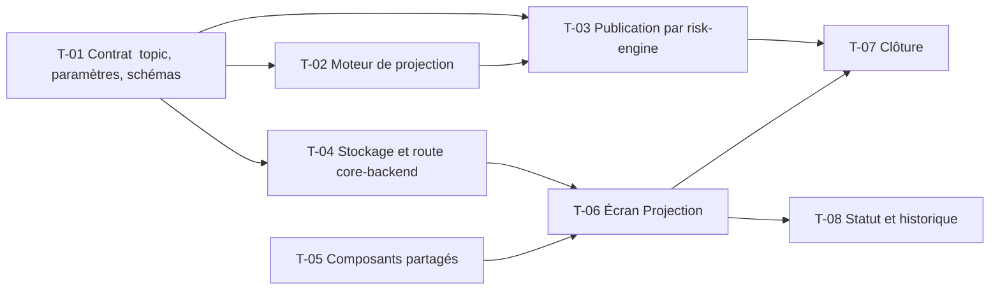

# 14 · Projection Monte Carlo — Tâches

> Décisions : `US.md`. Échelle de points, statuts et définition de terminé commune : [`roadmap/README.md`](../README.md). Points prévus et réalisés.

## Synthèse

| Tâche | Titre | US | Couche | Priorité | Points | Dépend de | Réalisé | Commits |
| --- | --- | --- | --- | --- | --- | --- | --- | --- |
| T-01 | Contrat : topic, paramètres et schémas de projection | US-01, US-03 | contracts | MUST | 2 | — | 2 | `8eee80e` |
| T-02 | Moteur de projection (risk-engine) | US-01, US-02 | risk-engine | MUST | 8 | T-01 | 8 | `f0810f1`, `da90c69`, `557e5f9` |
| T-03 | Publication de `projection.completed` par risk-engine | US-01, US-03 | risk-engine | MUST | 3 | T-01, T-02 | 3 | `197d9c6`, `da90c69` |
| T-04 | Stockage et route côté core-backend | US-01, US-03, US-04 | core-backend | MUST | 8 | T-01 | 8 | `860450c` |
| T-05 | Composants partagés de backtest | US-01 | web | MUST | 2 | — | 2 | `3c311a0` |
| T-06 | Écran Projection | US-01, US-02, US-04 | web | MUST | 8 | T-04, T-05 | 8 | `c44d08e`, `0c9bf77` |
| T-07 | Clôture : vérifications, dette, bilan | US-01 | docs | SHOULD | 1 | T-03, T-06 | 1 | `b3f72f8` |
| T-08 | Statut « en cours » et historique des calculs (D13) | US-05 | contracts, risk-engine, core-backend, web | SHOULD | 5 | T-06 | 5 | `795cc47`, `f5581cf`, `a4cc540`, `663e452` |

**Total** : 37 points — MUST 31, SHOULD 6. Les tâches T-01 à T-07 suivent les Tâches 1 à 7 de `PLAN.md` (la Tâche 0, maquette et roadmap, est faite).

| Lot | Tâches | Points |
| --- | --- | --- |
| 1. Contrat | T-01 | 2 |
| 2. Moteur et publication | T-02 → T-03 | 11 |
| 3. Service | T-04 | 8 |
| 4. Écrans | T-05 → T-06 | 10 |
| 5. Clôture | T-07 | 1 |
| 6. Extension D13 | T-08 | 5 |

**Chemin critique** (19 points) : T-01 → T-04 → T-06 → T-07. T-02 : la reproductibilité tient sur l'ordre de tirage fixe (jour puis trajectoire, un tirage par trajectoire au début de chaque bloc de `min(21, n)` jours) ; un test à seed fixe la protège. T-04 : colonnes nullables et première réception gagnante, pour le rejeu.

**Parallélisable** : T-01 et T-05 dès le début ; T-02 et T-04 après T-01 ; T-06 après T-04 et T-05.

## Graphe des dépendances

---

## Lot 1 — Contrat

### T-01 · Contrat : topic, paramètres et schémas de projection

- **US** : US-01, US-03 · **Priorité** : MUST · **Points** : 2 · **Dépend de** : — · **Commits** : `8eee80e`
- **Fichiers** : `packages/contracts/src/projection.ts`, `packages/contracts/src/index.ts`

Critères d’acceptation :
- [x] Topic `projection.completed`, `PROJECTION_PARAMS` (D6′), schémas de point, d'année et de projection, enveloppe `KafkaEvent` (D4′).
- [x] Chaque champ numérique documente son unité (EUR, ratio, jours ouvrés, date `YYYY-MM-DD`).
- [x] `ProjectionView` : états `COMPUTED`, `INSUFFICIENT_DATA`, `UNAVAILABLE`.

## Lot 2 — Moteur et publication

### T-02 · Moteur de projection (risk-engine)

- **US** : US-01, US-02 · **Priorité** : MUST · **Points** : 8 · **Dépend de** : T-01 · **Commits** : `f0810f1`, `da90c69`, `557e5f9`
- **Fichiers** : `apps/risk-engine/engine/projection.utils.ts`, `engine/projection.engine.ts`, `engine/risk.utils.ts`, `test/projection.*.test.ts`

Critères d’acceptation :
- [x] Même seed et mêmes entrées : sortie identique ; deux seeds donnent deux résultats différents.
- [x] Blocs de 21 jours ouvrés, 10 000 trajectoires, un seul calcul sur 2 520 jours (D2, D6′, D9) ; 121 points tous les 21 jours (D10).
- [x] Mêmes jours tirés pour tous les actifs, poids du backtest : corrélation conservée (D5) ; `portfolioReturns` partagé avec `computeRisk`.
- [x] Percentiles P5 à P95 (D7) et probabilité de perte à chaque fin d'année (D8′), arrondis à la publication seulement.
- [x] Moins de 2 jours communs ou actif sans cours (D12) : `null`. Rendements constants ou nuls : pas de division par zéro.

### T-03 · Publication de `projection.completed` par risk-engine

- **US** : US-01, US-03 · **Priorité** : MUST · **Points** : 3 · **Dépend de** : T-01, T-02 · **Commits** : `197d9c6`, `da90c69`
- **Fichiers** : `apps/risk-engine/services/risk.service.ts`, `publishers/risk.publisher.ts`, `consumers/risk.consumer.ts`, `index.ts`, `test/risk.service.test.ts`

Critères d’acceptation :
- [x] Après le risque, `projection.completed` est publié avec `executionId` et la projection (capital = `totalInvested`, seed 42).
- [x] Les cours EUR sont lus une seule fois pour le risque et la projection (D11).

## Lot 3 — Service

### T-04 · Stockage et route côté core-backend

- **US** : US-01, US-03, US-04 · **Priorité** : MUST · **Points** : 8 · **Dépend de** : T-01 · **Commits** : `860450c`
- **Fichiers** : `apps/core-backend/prisma/schema.prisma` et migration, `repositories/`, `services/`, `controller/`, `consumers/`, `routes/projection/`, `API.md`, `test/projection.*.test.ts`

Critères d’acceptation :
- [x] Colonnes `projection` et `projectionComputedAt` nullables ; un `projection.completed` rejoué n'écrase rien (première réception gagne).
- [x] `GET /api/projection/:backtestId` renvoie `COMPUTED`, `INSUFFICIENT_DATA` ou `UNAVAILABLE` ; 403 `ForbiddenError` pour un autre propriétaire, 404 pour un backtest inconnu (aligné sur Risque) ; jamais de 500 pour un ancien résultat.
- [x] Un message invalide est loggué et ignoré.
- [x] Section « Projection » de `API.md`.

## Lot 4 — Écrans

### T-05 · Composants partagés de backtest

- **US** : US-01 · **Priorité** : MUST · **Points** : 2 · **Dépend de** : — · **Commits** : `3c311a0`
- **Fichiers** : `apps/web/src/components/backtest-picker.tsx`, `state-card.tsx`, `features/risk/`, `COMPONENTS.md`

Critères d’acceptation :
- [x] `BacktestPicker` et `StateCard` déplacés vers `components/` ; page Risque inchangée.
- [x] Catalogues mis à jour.

### T-06 · Écran Projection

- **US** : US-01, US-02, US-04 · **Priorité** : MUST · **Points** : 8 · **Dépend de** : T-04, T-05 · **Commits** : `c44d08e`, `0c9bf77`
- **Fichiers** : `apps/web/src/features/projection/` (nouveau), `app/app/projection/page.tsx`, `lib/routes.ts`, `messages/{fr,en}.json`, `COMPONENTS.md`

Critères d’acceptation :
- [x] En-tête dans la forme de la page Risque : titre, badge, allocation et période, sélecteur de backtest (maquette 34).
- [x] Médiane et deux bandes P25-P75 et P10-P90 ; sélecteur d'horizon 1, 3, 5, 10 ans sans requête (D6′, D9).
- [x] Paramètres affichés en lecture seule ; probabilité de perte et tableau par horizon affichés tels que reçus, avec la mention « calculée sur des scénarios historiques, pas une promesse ».
- [x] États `UNAVAILABLE` (« Relancer le backtest ») et `INSUFFICIENT_DATA` (maquettes 34.1 et 34.2).
- [ ] Rendu comparé à la maquette avec le skill `verifier-rendu`. Non fait : l'app n'a pas tourné avec backend, Kafka et base pendant le développement (TD-41).

## Lot 5 — Clôture

### T-07 · Clôture : vérifications, dette, bilan

- **US** : US-01 · **Priorité** : SHOULD · **Points** : 1 · **Dépend de** : T-03, T-06 · **Commits** : `b3f72f8`
- **Fichiers** : `TECH-DEBT.md`, `roadmap/README.md`, `roadmap/14-projection-monte-carlo/`

Critères d’acceptation :
- [x] `verify` et les contrôles manuels de `AGENTS.md` passés ; dette repérée ajoutée à `TECH-DEBT.md`.
- [x] Critères cochés, commits et bilan écrits, statut `Livrée` dans l'index.
- [x] Redémarrage de `risk-engine` et `core-backend` signalé (nouveau topic et contrat).

## Lot 6 — Extension D13

### T-08 · Statut « en cours » et historique des calculs

- **US** : US-05 · **Priorité** : SHOULD · **Points** : 5 · **Dépend de** : T-06 · **Commits** : `795cc47`, `f5581cf`, `a4cc540`, `663e452`
- **Fichiers** : `packages/contracts/src/projection.ts`, `apps/risk-engine/services/risk.service.ts`, `apps/core-backend/{prisma,repositories,services,interfaces,API.md}`, `apps/web/src/features/{projection,backtest}/`, `messages/{fr,en}.json`, catalogues, `TECH-DEBT.md` (TD-39 fermée)

Critères d’acceptation :
- [x] risk-engine mesure `computeProjection` et publie `durationMs` (entier, ms) ; contrat et test.
- [x] Prisma `projectionExpected` (`@default(false)`, vrai à la création d'un résultat) et `projectionDurationMs` ; migration `add_backtest_result_projection_status`.
- [x] Service : état `PENDING`, fonction unique d'état pour la vue et les lignes de `history`, triée par tentative décroissante ; tests service, route, repository, consumer.
- [x] Web : badge `En cours`, carte d'état, rafraîchissement par `awaitResultPollMs` (déplacé dans `result-wait.ts`, TD-39), « Réessayer » passé 2 min, `ProjectionHistory`.
- [x] Catalogues à jour.
- [ ] Rendu comparé à la maquette (historique des calculs en cours de mise à jour dans Figma) : non fait (TD-41).
