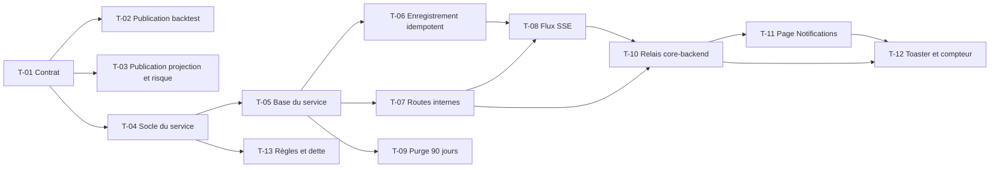

# 15 · Service de notification — Tâches

> Décisions : `README.md` (D1 à D16). Échelle de points, statuts et définition de terminé commune : [`roadmap/README.md`](../README.md). Points prévus. Le nouveau service copie l'architecture de `apps/market-service` et `apps/risk-engine` (règle d'or de `AGENTS.md`).

## Synthèse

| Tâche | Titre | US | Couche | Priorité | Points | Dépend de | Commits |
| --- | --- | --- | --- | --- | --- | --- | --- |
| T-01 | Contrat : topic, types, paramètres et DTO de notification | US-01, US-02 | contracts | MUST | 2 | — | `ea7e4d9` |
| T-02 | core-backend : publier les notifications de backtest | US-01 | core-backend | MUST | 5 | T-01 | `e677be0` |
| T-03 | core-backend : publier projection et contrainte de risque | US-01 | core-backend | MUST | 3 | T-01 | `3ad8980` |
| T-04 | Socle du service : env, health, consumer branché, script `dev` | US-01 | notification-service | MUST | 3 | T-01 | `e657b95` |
| T-05 | Base du service : schéma Prisma, migration, repository, CI | US-01, US-02 | notification-service | MUST | 5 | T-04 | `2b838e5` |
| T-06 | Service et consumer : enregistrement idempotent | US-01 | notification-service | MUST | 5 | T-05 | `66bc2fd` |
| T-07 | Routes internes : liste, compteur, lu, tout lire | US-02, US-03 | notification-service | MUST | 3 | T-05 | `12583d9` |
| T-08 | Flux SSE par utilisateur | US-04 | notification-service | MUST | 3 | T-06, T-07 | `77f42e8` |
| T-09 | Purge à 90 jours | US-02 | notification-service | MUST | 2 | T-05 | `38d3f70` |
| T-10 | core-backend : relais `/api/notifications` (dont SSE) | US-02, US-03, US-04 | core-backend | MUST | 3 | T-07, T-08 | `820fe97` |
| T-11 | Page Notifications | US-02, US-03 | web | MUST | 5 | T-10 | `6079065`, `3d5aac9` |
| T-12 | Toaster et compteur de la sidebar | US-03, US-04 | web | MUST | 5 | T-10, T-11 | `28e610c`, `7b7644f` |
| T-13 | Règles, documentation et dette | US-01 | docs | MUST | 2 | T-04 | `b185426` |

**Total** : 46 points — MUST 46, SHOULD 0.

| Lot | Tâches | Points |
| --- | --- | --- |
| 1. Contrat et sources | T-01 → T-03 | 10 |
| 2. Service | T-04 → T-09 | 21 |
| 3. Relais | T-10 | 3 |
| 4. Web | T-11 → T-12 | 10 |
| 5. Règles et dette | T-13 | 2 |

**Chemin critique** (26 points) : T-01 → T-04 → T-05 → T-06 → T-08 → T-10 → T-12. T-08 : le flux SSE traverse le proxy de core-backend (`proxyTo` a un délai de 10 s et peut mettre les réponses en mémoire tampon) ; à vérifier avec un vrai flux avant de coder le toaster.

**Parallélisable** : T-02 et T-03 pendant T-04 → T-06 (seul le contrat les lie) ; T-07 et T-09 après T-05 ; T-13 dès T-04.

## Graphe des dépendances

---

## Lot 1 — Contrat et sources

### T-01 · Contrat : topic, types, paramètres et DTO de notification

- **US** : US-01, US-02 · **Priorité** : MUST · **Points** : 2 · **Dépend de** : — · **Commits** : `ea7e4d9`
- **Fichiers** : `packages/contracts/src/notification.ts` (nouveau), `packages/contracts/src/index.ts`, `packages/contracts/test/notification.test.ts`

Critères d’acceptation :
- [ ] `NOTIFICATION_TOPICS.requested = "notification.requested"`, `NOTIFICATION_TYPES`, `NOTIFICATION_CATEGORIES` (`BACKTESTS`, `RISK`) et la table type → catégorie en constantes.
- [ ] `notificationRequestedPayloadSchema` : `userId`, `type`, `dedupKey`, `occurredAt`, `params` discriminés par `type` (nom du backtest, `backtestId`, valeurs chiffrées affichées) ; chaque nombre commente son unité (ratio, nombre d'entiers) ; aucun texte rendu.
- [ ] `NotificationView` (id, type, catégorie, params, `createdAt`, `readAt`) et `NotificationList` (`Paginated<NotificationView>` + `counts` : `all`, `unread`, une entrée par catégorie + `retentionDays`), dérivés des schémas.
- [ ] Test : un payload par type est accepté, un `type` inconnu ou un paramètre manquant est refusé.

### T-02 · core-backend : publier les notifications de backtest

- **US** : US-01 · **Priorité** : MUST · **Points** : 5 · **Dépend de** : T-01 · **Commits** : `e677be0`
- **Fichiers** : `apps/core-backend/services/backtest.service.ts`, `apps/core-backend/repositories/backtest.repository.ts`, `apps/core-backend/test/backtest.service.test.ts`, `apps/core-backend/test/backtest.repository.test.ts`

Critères d’acceptation :
- [ ] `complete` publie `BACKTEST_COMPLETED` (nom, CAGR, Sharpe, drawdown maximal, ratios) seulement si la transition a modifié une ligne ; `fail` publie `BACKTEST_FAILED` (nom, `errorCode`) de même.
- [ ] `failStaleExecutions` identifie les exécutions expirées (propriétaire, backtest, exécution) et publie une `BACKTEST_FAILED` par exécution ; le repository renvoie ces lignes dans la même transaction que la mise à jour.
- [ ] `dedupKey` = `<type>:<executionId>` ; un rejeu qui ne modifie rien ne publie rien.
- [ ] Un échec de publication est loggué (`logger.error`) et ne remet pas en cause la transition déjà commitée (D7).
- [ ] Tests : transition modifiée → publié ; rejeu → rien ; balayage de deux exécutions → deux événements.

### T-03 · core-backend : publier projection et contrainte de risque

- **US** : US-01 · **Priorité** : MUST · **Points** : 3 · **Dépend de** : T-01 · **Commits** : `3ad8980`
- **Fichiers** : `apps/core-backend/services/projection.service.ts`, `apps/core-backend/services/risk.service.ts`, `apps/core-backend/test/projection.service.test.ts`, `apps/core-backend/test/risk.service.test.ts`

Critères d’acceptation :
- [ ] `ProjectionService.store` publie `PROJECTION_COMPLETED` (nom, nombre de scénarios, probabilité de perte à l'horizon final, ratio) à la première réception d'une projection non nulle ; rien pour `null` ni pour un rejeu.
- [ ] `RiskService.setLimit` publie `RISK_CONSTRAINT_VIOLATED` (nom, drawdown mesuré et limite, ratios) quand la nouvelle limite rend la contrainte `VIOLATED` ; rien pour une limite identique ou respectée. `dedupKey` = `<type>:<backtestId>:<limite>`.
- [ ] Même gestion d'échec de publication que T-02. Une fonction partagée de publication dans `services/` évite de répéter `createKafkaEvent` (règle « Doublons »).
- [ ] Tests : un cas publié et un cas ignoré par méthode.

## Lot 2 — Service

### T-04 · Socle du service : env, health, consumer branché, script `dev`

- **US** : US-01 · **Priorité** : MUST · **Points** : 3 · **Dépend de** : T-01 · **Commits** : `e657b95`
- **Fichiers** : `apps/notification-service/` (`package.json`, `tsconfig.json`, `bunfig.toml`, `env.ts`, `index.ts`, `AGENTS.md`, `CLAUDE.md`, `test/setup.ts`), `package.json` racine (workspace, script `dev:notification`, ajout à `dev`)

Critères d’acceptation :
- [ ] Même forme que `market-service` : `env.ts` (port 8002, `INTERNAL_API_KEY` partagée, `DATABASE_URL`, Kafka), `main().catch` avec `process.exitCode = 1`, `onShutdown`, `GET /health`.
- [ ] Un middleware refuse tout appel sans `INTERNAL_KEY_HEADER` valide et sans `x-user-id` (hors `/health`).
- [ ] Groupe de consommateurs propre (`notification-service`) sur `notification.requested`.
- [ ] `AGENTS.md` du dossier : couches (routes, controller, consumer, service, repository), copie de la section « Règles par couche » de core-backend.
- [ ] `bunx tsc --noEmit` passe ; `bun run dev` démarre le service.

### T-05 · Base du service : schéma Prisma, migration, repository, CI

- **US** : US-01, US-02 · **Priorité** : MUST · **Points** : 5 · **Dépend de** : T-04 · **Commits** : `2b838e5`
- **Fichiers** : `apps/notification-service/prisma/schema.prisma`, migration initiale, `prisma.config.ts`, `.env.example`, `repositories/notification.repository.ts`, `test/notification.repository.test.ts`, `.github/workflows/ci.yml`

Critères d’acceptation :
- [ ] Modèle `Notification` : `id`, `userId`, `type`, `category`, `params` (Json), `dedupKey` (unique), `createdAt`, `readAt` (nullable) ; index `(userId, createdAt)`.
- [ ] Repository (`I`/classe, Prisma Client seulement) : `create` idempotent (renvoie la ligne créée ou `null` sur `dedupKey` existante), `list` (filtre `category`, `unread`, pagination), `counts` (total, non lues, par catégorie, sans filtre), `countUnread`, `markRead` (filtré sur `userId`), `markAllRead`, `deleteOlderThan`.
- [ ] Base `notifications` (`DATABASE_URL` propre, `.env.example`) et base de test `notifications_test` forcée par `test/setup.ts` (`describeWithDb`, comme core-backend) ; tests ignorés si PostgreSQL est éteint (D16).
- [ ] CI : `notification-service` dans la matrice de tests, `db:generate` avant ses tests, base `notifications_test` créée dans le service PostgreSQL.
- [ ] Tests : doublon, isolation par utilisateur, filtres, pagination.

### T-06 · Service et consumer : enregistrement idempotent

- **US** : US-01 · **Priorité** : MUST · **Points** : 5 · **Dépend de** : T-05 · **Commits** : `66bc2fd`
- **Fichiers** : `apps/notification-service/consumers/notification.consumer.ts`, `services/notification.service.ts`, `constants/notification.constants.ts`, `test/notification.consumer.test.ts`, `test/notification.service.test.ts`

Critères d’acceptation :
- [ ] Le consumer valide le message avec le schéma de `@azimut/contracts` ; invalide → `logger.warn` et retour, sans exception.
- [ ] Le service déduit la catégorie du type, enregistre, et ne diffuse (T-08) que si la ligne vient d'être créée.
- [ ] Un handler qui lève (base indisponible) laisse kafkajs rejouer le message.
- [ ] Tests (faux repository assigné à `service.repo`) : création, rejeu sans doublon, message invalide ignoré.

### T-07 · Routes internes : liste, compteur, lu, tout lire

- **US** : US-02, US-03 · **Priorité** : MUST · **Points** : 3 · **Dépend de** : T-05 · **Commits** : `12583d9`
- **Fichiers** : `apps/notification-service/routes/notification/`, `controller/notification.controller.ts`, `interfaces/notification.interface.ts`, `API.md`, `test/notification.routes.test.ts`

Critères d’acceptation :
- [ ] `GET /notifications` (filtres `category`, `unread`, pagination existante, réponse `NotificationList` avec `counts` et `retentionDays`), `GET /notifications/unread-count`, `POST /notifications/:id/read`, `POST /notifications/read-all`.
- [ ] `userId` vient du seul en-tête `x-user-id` ; la notification d'un autre utilisateur répond `404` (`NotFoundError`).
- [ ] `read` et `read-all` sont idempotents.
- [ ] `API.md` (gabarit de `market-service/API.md`) ; routes testées avec `startApp` de `@azimut/http/testing`.

### T-08 · Flux SSE par utilisateur

- **US** : US-04 · **Priorité** : MUST · **Points** : 3 · **Dépend de** : T-06, T-07 · **Commits** : `77f42e8`
- **Fichiers** : `apps/notification-service/services/notification-stream.service.ts`, `controller/notification.controller.ts`, `routes/notification/`, `test/notification-stream.test.ts`

Critères d’acceptation :
- [ ] `GET /notifications/stream` répond `text/event-stream`, garde la connexion ouverte, envoie un battement toutes les 25 s et diffuse chaque nouvelle `NotificationView` au seul utilisateur concerné.
- [ ] Les connexions d'un utilisateur sont retirées à la fermeture du client ; plusieurs onglets reçoivent tous la notification.
- [ ] Une notification déjà vue (rejeu) n'est pas rediffusée (T-06).
- [ ] Test : deux utilisateurs connectés, une notification, un seul récepteur ; fermeture libère l'abonné.

### T-09 · Purge à 90 jours

- **US** : US-02 · **Priorité** : MUST · **Points** : 2 · **Dépend de** : T-05 · **Commits** : `38d3f70`
- **Fichiers** : `apps/notification-service/constants/notification.constants.ts`, `services/notification.service.ts`, `index.ts`, `test/notification.service.test.ts`

Critères d’acceptation :
- [ ] `NOTIFICATION_RETENTION_DAYS = 90` ; une tâche périodique (une fois par heure, arrêtée par `onShutdown`) supprime les notifications plus anciennes ; erreur loggué, sans arrêter le service.
- [ ] La valeur est exposée au web (`retentionDays` de la liste) pour la mention « Conservées 90 jours » : le web n'écrit pas « 90 ».
- [ ] Test : seules les notifications de plus de 90 jours disparaissent.

## Lot 3 — Relais

### T-10 · core-backend : relais `/api/notifications` (dont SSE)

- **US** : US-02, US-03, US-04 · **Priorité** : MUST · **Points** : 3 · **Dépend de** : T-07, T-08 · **Commits** : `820fe97`
- **Fichiers** : `apps/core-backend/routes/notification/`, `apps/core-backend/utils/proxy.ts`, `apps/core-backend/env.ts`, `apps/core-backend/index.ts`, `apps/core-backend/API.md`, `apps/core-backend/test/notification.routes.test.ts`

Critères d’acceptation :
- [ ] Les cinq routes de D9 sont relayées derrière `authMiddleware` (liste blanche, comme `routes/market/`) ; `NOTIFICATION_SERVICE_URL` dans `env.ts`.
- [ ] Le flux SSE n'est ni coupé par `proxyTimeout` ni mis en mémoire tampon, et la route répond `401` sans session ; `proxyTo` gère ce cas sans casser les autres routes.
- [ ] Vérifié avec un vrai flux : un événement poussé par le service arrive au client en moins d'une seconde.
- [ ] Entrées dans `API.md` (méthode, chemin, auth, réponse, erreurs, appelant web).

## Lot 4 — Web

### T-11 · Page Notifications

- **US** : US-02, US-03 · **Priorité** : MUST · **Points** : 5 · **Dépend de** : T-10 · **Commits** : `6079065`, `3d5aac9`
- **Fichiers** : `apps/web/src/features/notifications/` (`api.ts`, `hook.ts`, `types.ts`, `constants.ts`, `utils.ts`, composants, `COMPONENTS.md`), `apps/web/src/app/app/notifications/page.tsx`, `apps/web/messages/fr.json`, `apps/web/messages/en.json`, `apps/web/COMPONENTS.md`, `apps/web/test/notifications.test.tsx`

Critères d’acceptation :
- [ ] Écran conforme à `22 · Notifications` : en-tête avec pastille « n non lues », « Tout marquer comme lu », onglets avec nombres (`counts`), pagination existante, groupes par jour, ligne (icône d'état, titre, détail, « Voir », pastille non lu), état vide, « Conservées n jours ».
- [ ] Textes de chaque type dans les dictionnaires FR/EN à partir des paramètres reçus (formatters de `lib/format.ts` pour ratios et dates) ; aucune valeur calculée ni comptée côté web.
- [ ] « Voir » navigue vers le résultat (`routes.backtest`, `routes.backtestRisk`, `routes.backtestProjection`) et marque lue ; « Tout marquer comme lu » met la liste et le compteur à jour.
- [ ] Tests avec `test/render.tsx` : groupes, onglets, marquage lu, état vide. `COMPONENTS.md` à jour ; comparaison visuelle avec Figma (`verifier-rendu`).

### T-12 · Toaster et compteur de la sidebar

- **US** : US-03, US-04 · **Priorité** : MUST · **Points** : 5 · **Dépend de** : T-10, T-11 · **Commits** : `28e610c`, `7b7644f`
- **Fichiers** : `apps/web/src/components/` (primitive Toast, si absente de shadcn/base-ui), `apps/web/src/features/notifications/` (`stream.ts`, `toaster.tsx`), `apps/web/src/components/app-sidebar.tsx`, `apps/web/src/app/app/layout.tsx`, `apps/web/test/notifications-stream.test.tsx`

Critères d’acceptation :
- [ ] Un `EventSource` (cookies inclus) est ouvert une seule fois pour toute la zone `/app` ; à chaque notification : toaster `22.1` (au plus 3 empilés, fermeture automatique et par croix, « Voir » qui marque lue), compteur de la sidebar et liste mis à jour sans doublon. Pas de toaster sur `/app/notifications` (D15).
- [ ] À la reconnexion du flux, le compteur et la liste sont rechargés.
- [ ] Le compteur de la sidebar vient de `GET /api/notifications/unread-count` ; masqué à 0.
- [ ] Aucune dépendance ajoutée sans la justifier (primitive shadcn/base-ui d'abord, `COMPONENTS.md` à jour).
- [ ] Test avec un `EventSource` simulé : notification reçue → toaster, compteur et liste.

## Lot 5 — Règles et dette

### T-13 · Règles, documentation et dette

- **US** : US-01 · **Priorité** : MUST · **Points** : 2 · **Dépend de** : T-04 · **Commits** : `b185426`
- **Fichiers** : `AGENTS.md`, `CLAUDE.md`, `apps/core-backend/AGENTS.md`, `README.md`, `TECH-DEBT.md`, `roadmap/README.md`

Critères d’acceptation :
- [ ] `AGENTS.md` racine : ligne `apps/notification-service` dans « Structure » ; table « Responsabilités » ; exception d'écriture en base (« core-backend seul écrivain en base, sauf `notification-service` pour sa base `notifications` ») ; `notification.requested` dans « Contrats et événements Kafka ».
- [ ] `CLAUDE.md` : règle 3 de « Revue de code » (propriété des accès) amendée ; `apps/core-backend/AGENTS.md` : phrase « seul service qui écrit en base » amendée.
- [ ] `README.md` racine : section « Notifications » alignée (service, SSE, types, rétention) et canal WebSocket corrigé.
- [ ] `TECH-DEBT.md` : ligne « pas d'outbox » (D7), sans doublon avec une ligne existante.
- [ ] `bun run verify` passe ; `roadmap/README.md` : statut et points de la feature.
