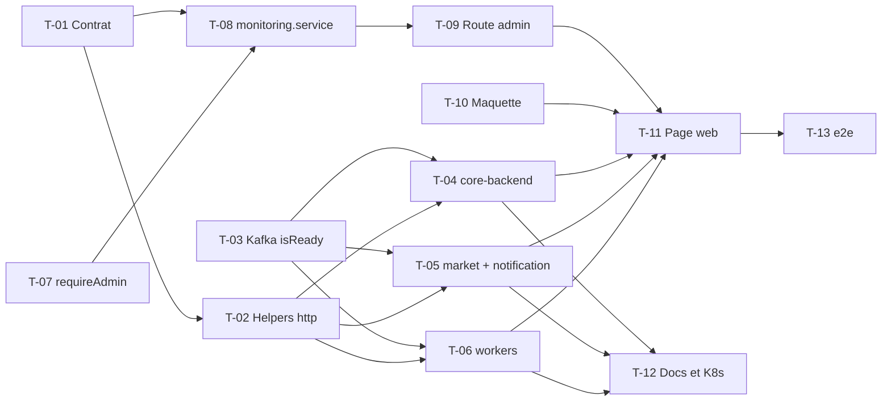

# 16 · Monitoring : sondes de santé et page d'état des services — Tâches

> Échelle de points, statuts et définition de terminé commune : `roadmap/README.md`. Points prévus.

## Synthèse

| Tâche | Titre | US | Couche | Priorité | Points | Dépend de | Commits |
| --- | --- | --- | --- | --- | --- | --- | --- |
| T-01 | Contrat `monitoring.ts` | US-01 | contracts | MUST | 2 | — | — |
| T-02 | Helpers de sondes dans `packages/http` | US-01 | http | MUST | 3 | T-01 | — |
| T-03 | `isReady()` sur `KafkaConsumer` et `KafkaProducer` | US-01 | kafka | MUST | 3 | — | — |
| T-04 | Sondes de `core-backend` (remplace `/health`) | US-01 | core-backend | MUST | 2 | T-02, T-03 | — |
| T-05 | Sondes de `market-service` et `notification-service` | US-01 | services | MUST | 3 | T-02, T-03 | — |
| T-06 | Serveur de sondes des workers `backtest-engine` et `risk-engine` | US-01 | engines | MUST | 3 | T-02, T-03 | — |
| T-07 | Middleware `requireAdmin` | US-02 | core-backend | MUST | 2 | — | — |
| T-08 | `monitoring.service` : interroger les services et calculer l'état | US-02 | core-backend | MUST | 5 | T-01, T-07 | — |
| T-09 | Route `GET /api/admin/monitoring/services` | US-02 | core-backend | MUST | 2 | T-08 | — |
| T-10 | Maquette : écran 09 réduit aux statuts | US-02 | maquette | MUST | 2 | — | — |
| T-11 | Page Monitoring : tableau d'état, rafraîchissement 15 s | US-02 | web | MUST | 5 | T-04, T-05, T-06, T-09, T-10 | — |
| T-12 | Raccorder Kubernetes, `AGENTS.md`, index et README | US-03 | documentation | MUST | 1 | T-04, T-05, T-06 | — |
| T-13 | Test e2e de la page Monitoring | US-02 | web | SHOULD | 2 | T-11 | — |

**Total** : 35 points — MUST 33, SHOULD 2.

| Lot | Tâches | Points |
| --- | --- | --- |
| 1. Sondes | T-01 → T-06 | 16 |
| 2. Agrégation et page | T-07 → T-11, T-13 | 18 |
| 3. Raccordement à Kubernetes | T-12 | 1 |

**Chemin critique** (16 points) : T-01 → T-08 → T-09 → T-11 → T-13. T-08 est la tâche la plus risquée : appels parallèles avec délai, règles `up` / `degraded` / `down`, cas du service injoignable ; à commencer tôt.

**Parallélisable** : T-01, T-03, T-07 et T-10 n'ont pas de dépendance commune ; T-04, T-05 et T-06 se font en parallèle une fois T-02 et T-03 terminées.

## Graphe des dépendances

---

## Lot 1 — Sondes

### T-01 · Contrat `monitoring.ts`

- **US** : US-01 · **Priorité** : MUST · **Points** : 2 · **Dépend de** : — · **Commits** : —
- **Fichiers** : `packages/contracts/src/monitoring.ts`, `packages/contracts/src/index.ts`

Critères d’acceptation :
- [ ] Schéma zod de la réponse d'une sonde : `status` (`ok` pour la liveness ; `ok` / `unavailable` pour la readiness) et `checks` optionnel (`database`, `kafka`, `provider` : `"ok"` ou `"down"`).
- [ ] Schéma d'une ligne de la page : `service`, `state` (`up` / `degraded` / `down`), `checks`, `latencyMs` (unité commentée : millisecondes), `checkedAt`.
- [ ] Schéma de la réponse de la page : `services` (lignes) et `summary` (`total`, `up`, `degraded`, `down`, `downServices`) (D9).
- [ ] Liste des services surveillés exportée une seule fois ; types dérivés de zod, jamais recopiés.

### T-02 · Helpers de sondes dans `packages/http`

- **US** : US-01 · **Priorité** : MUST · **Points** : 3 · **Dépend de** : T-01 · **Commits** : —
- **Fichiers** : `packages/http/src/probes.ts`, `packages/http/src/index.ts`, `packages/http/test/probes.test.ts`

Critères d’acceptation :
- [ ] Une fonction enregistre `GET /liveness` et `GET /readiness` sur une application Express à partir d'une liste de contrôles (fonction `() => Promise<boolean>` nommée).
- [ ] Une fonction démarre un serveur `node:http` minimal sur un port, avec les mêmes deux routes, pour les workers ; arrêt propre via `onShutdown`.
- [ ] `/readiness` renvoie `503` dès qu'un contrôle échoue ou lève, `checks` liste chaque contrôle ; une exception ne fait jamais tomber le process.
- [ ] Tests : tous les contrôles OK, un contrôle KO, un contrôle qui lève, liveness indépendante des contrôles.

### T-03 · `isReady()` sur `KafkaConsumer` et `KafkaProducer`

- **US** : US-01 · **Priorité** : MUST · **Points** : 3 · **Dépend de** : — · **Commits** : —
- **Fichiers** : `packages/kafka/src/kafka.consumer.ts`, `packages/kafka/src/kafka.producer.ts`, `packages/kafka/test/`

Critères d’acceptation :
- [ ] `KafkaConsumer.isReady()` devient vrai après `GROUP_JOIN` et faux après `CRASH`, `STOP` ou `DISCONNECT` (décision D4).
- [ ] `KafkaProducer.isReady()` suit `CONNECT` et `DISCONNECT`.
- [ ] Les écouteurs sont posés dans `connect()` ; l'API existante (`connect`, `subscribe`, `consume`, `disconnect`) ne change pas.
- [ ] Tests avec un client `kafkajs` simulé : état initial faux, vrai après jointure, faux après crash.

### T-04 · Sondes de `core-backend` (remplace `/health`)

- **US** : US-01 · **Priorité** : MUST · **Points** : 2 · **Dépend de** : T-02, T-03 · **Commits** : —
- **Fichiers** : `apps/core-backend/index.ts`, `apps/core-backend/utils/db.ts`, `apps/core-backend/API.md`

Critères d’acceptation :
- [ ] `GET /health` est supprimé ; `/liveness` et `/readiness` sont enregistrés avant `helmet` et les limiteurs, sans auth.
- [ ] `/readiness` contrôle la base (`isDbConnected`, déjà existante) et le consumer et le producer Kafka (`isReady()`).
- [ ] `API.md` : section « Santé » et ordre d'enregistrement mis à jour.

### T-05 · Sondes de `market-service` et `notification-service`

- **US** : US-01 · **Priorité** : MUST · **Points** : 3 · **Dépend de** : T-02, T-03 · **Commits** : —
- **Fichiers** : `apps/market-service/index.ts`, `apps/market-service/API.md`, `apps/market-service/AGENTS.md`, `apps/notification-service/index.ts`, `apps/notification-service/API.md`, `apps/notification-service/AGENTS.md`, `apps/notification-service/test/internal-auth.middleware.test.ts`

Critères d’acceptation :
- [ ] `GET /health` est supprimé des deux services ; `/liveness` et `/readiness` sont enregistrés avant `internalAuthMiddleware`, donc sans clé interne.
- [ ] `market-service` : readiness = fournisseur Yahoo (`provider`), requête légère sur un symbole fixe, délai 1,5 s, résultat gardé 60 s dans `TtlCache` (D3, D10) ; test du contrôle (succès, échec, délai, cache).
- [ ] `notification-service` : readiness = base `notifications` + consumer Kafka.
- [ ] Le test d'authentification interne remplace `/health` par les deux nouvelles routes ; `API.md` et `AGENTS.md` des deux services à jour.

### T-06 · Serveur de sondes des workers `backtest-engine` et `risk-engine`

- **US** : US-01 · **Priorité** : MUST · **Points** : 3 · **Dépend de** : T-02, T-03 · **Commits** : —
- **Fichiers** : `apps/backtest-engine/index.ts`, `apps/backtest-engine/env.ts`, `apps/backtest-engine/README.md`, `apps/risk-engine/index.ts`, `apps/risk-engine/env.ts`, `apps/risk-engine/AGENTS.md`

Critères d’acceptation :
- [ ] `HEALTH_PORT` ajouté à chaque `env.ts` (8003 et 8004 par défaut), `.env.example` à jour.
- [ ] Le serveur de sondes démarre avant la connexion à Kafka (la liveness répond pendant le démarrage) ; la readiness exige consumer et producer prêts.
- [ ] Le serveur s'arrête avec `onShutdown`, sans bloquer l'arrêt du consumer.
- [ ] Docs des deux workers : port de sonde et routes.

---

## Lot 2 — Agrégation et page

### T-07 · Middleware `requireAdmin`

- **US** : US-02 · **Priorité** : MUST · **Points** : 2 · **Dépend de** : — · **Commits** : —
- **Fichiers** : `apps/core-backend/middleware/admin.middleware.ts`, `apps/core-backend/middleware/auth.middleware.ts`, `apps/core-backend/test/`

Critères d’acceptation :
- [ ] Sans session : `401` ; session sans rôle administrateur : `403` (`ForbiddenError` de `@azimut/http`) ; administrateur : la requête passe.
- [ ] Le rôle vient de la session `better-auth` (plugin `admin()`), jamais du body ni de la query.
- [ ] Tests des trois cas ; aucune duplication de la lecture de session de `authMiddleware`.

### T-08 · `monitoring.service` : interroger les services et calculer l'état

- **US** : US-02 · **Priorité** : MUST · **Points** : 5 · **Dépend de** : T-01, T-07 · **Commits** : —
- **Fichiers** : `apps/core-backend/services/monitoring.service.ts`, `apps/core-backend/env.ts`, `apps/core-backend/constants/monitoring.constants.ts`, `apps/core-backend/test/`

Critères d’acceptation :
- [ ] Les URL de sonde des cinq services viennent de `env.ts` (`MARKET_SERVICE_URL`, `NOTIFICATION_SERVICE_URL` existantes ; `BACKTEST_ENGINE_HEALTH_URL`, `RISK_ENGINE_HEALTH_URL` ajoutées) ; core-backend se sonde lui-même sans appel réseau.
- [ ] Appels en parallèle, délai de 2 s par service (constante), un service lent ne retarde pas les autres.
- [ ] États : `200` → `up`, `503` → `degraded` avec `checks` repris de la réponse, délai dépassé ou connexion refusée → `down` ; `latencyMs` mesuré ; réponse non conforme au contrat → `down`.
- [ ] Synthèse `summary` calculée ici (D9) : `total`, `up`, `degraded`, `down`, `downServices` (noms dans l'ordre des services surveillés).
- [ ] Aucune dépendance à `prisma`, `req` ou `res` ; tests avec un `fetch` simulé : tous `up`, un `degraded`, un `down` par délai, un `down` par refus.

### T-09 · Route `GET /api/admin/monitoring/services`

- **US** : US-02 · **Priorité** : MUST · **Points** : 2 · **Dépend de** : T-08 · **Commits** : —
- **Fichiers** : `apps/core-backend/controller/monitoring.controller.ts`, `apps/core-backend/routes/monitoring/`, `apps/core-backend/index.ts`, `apps/core-backend/API.md`

Critères d’acceptation :
- [ ] Route protégée par `authMiddleware` puis `requireAdmin` ; réponse validée par le schéma du contrat.
- [ ] Controller sans logique métier (délègue à `monitoring.service`).
- [ ] `API.md` : route, codes `401` / `403`, forme de la réponse.

### T-10 · Maquette : écran 09 réduit aux statuts

- **US** : US-02 · **Priorité** : MUST · **Points** : 2 · **Dépend de** : — · **Commits** : —
- **Fichiers** : Figma `Trading` : écran `09 · Monitoring` (node `22:1954`), copie `09 · Monitoring · à modifier (F16)` dans la section `Feature 16 · Monitoring`

Critères d’acceptation :
- [ ] La copie ne garde que les quatre cartes de synthèse et le tableau « Services » : lignes `core-backend`, `market-service`, `notification-service`, `backtest-engine`, `risk-engine` ; colonnes Service, Statut (`up` / `degraded` / `down`), Dépendances (base, Kafka, Yahoo), Latence, Dernière vérification.
- [ ] États `degraded` et `down` dessinés ; états chargement et erreur de l'appel dessinés (D11).
- [ ] Validée par l'utilisateur avant T-11 ; l'original (section Feature 04) reste intact jusqu'au codage.

### T-11 · Page Monitoring : tableau d'état, rafraîchissement 15 s

- **US** : US-02 · **Priorité** : MUST · **Points** : 5 · **Dépend de** : T-04, T-05, T-06, T-09, T-10 · **Commits** : —
- **Fichiers** : `apps/web/src/app/app/(admin)/monitoring/page.tsx`, `apps/web/src/features/monitoring/`, `apps/web/src/lib/api.ts`, `apps/web/messages/fr.json`, `apps/web/messages/en.json`, `apps/web/COMPONENTS.md`

Critères d’acceptation :
- [ ] Écran conforme à la copie validée en T-10 ; primitives shadcn (`Table`, `Badge`, `Card`), aucun HTML brut sans raison.
- [ ] Rafraîchissement toutes les 15 s (constante nommée), indicateur de chargement et d'erreur de l'appel lui-même.
- [ ] Le web n'interprète pas les sondes : il affiche `state`, `checks`, `latencyMs`, `checkedAt` et `summary` reçus, sans compter.
- [ ] Textes dans les dictionnaires FR et EN, locale non codée en dur ; appel via `api.ts`.
- [ ] `COMPONENTS.md` mis à jour ; `bunx tsc --noEmit` et `bun run lint` passent.
- [ ] Avec les cinq services lancés, les cinq lignes sont `up` ; en arrêtant Kafka, les services concernés passent `degraded`.

### T-13 · Test e2e de la page Monitoring

- **US** : US-02 · **Priorité** : SHOULD · **Points** : 2 · **Dépend de** : T-11 · **Commits** : —
- **Fichiers** : `apps/web/e2e/monitoring.e2e.ts`, `apps/web/e2e/fake-market.ts`

Critères d’acceptation :
- [ ] `fake-market.ts` répond à `/readiness` et `/liveness` au lieu de `/health`.
- [ ] Un administrateur voit le tableau ; un compte standard est redirigé et ne voit pas l'entrée de sidebar.

---

## Lot 3 — Raccordement à Kubernetes

### T-12 · Raccorder Kubernetes, `AGENTS.md`, index et README

- **US** : US-03 · **Priorité** : MUST · **Points** : 1 · **Dépend de** : T-04, T-05, T-06 · **Commits** : —
- **Fichiers** : `AGENTS.md`, `roadmap/24-kubernetes-helm-argocd/{README,US,TASKS}.md`, `roadmap/README.md`, `README.md`

Critères d’acceptation :
- [ ] `AGENTS.md` racine (cycle de vie des process) cite `/liveness` et `/readiness` et non `/health`.
- [ ] Feature 24 : « Dépend de » liste la 16 ; la tâche des charts ne garde que la configuration des probes.
- [ ] `roadmap/README.md` : index, journal des décisions ; `README.md` racine : roadmap annuelle.
