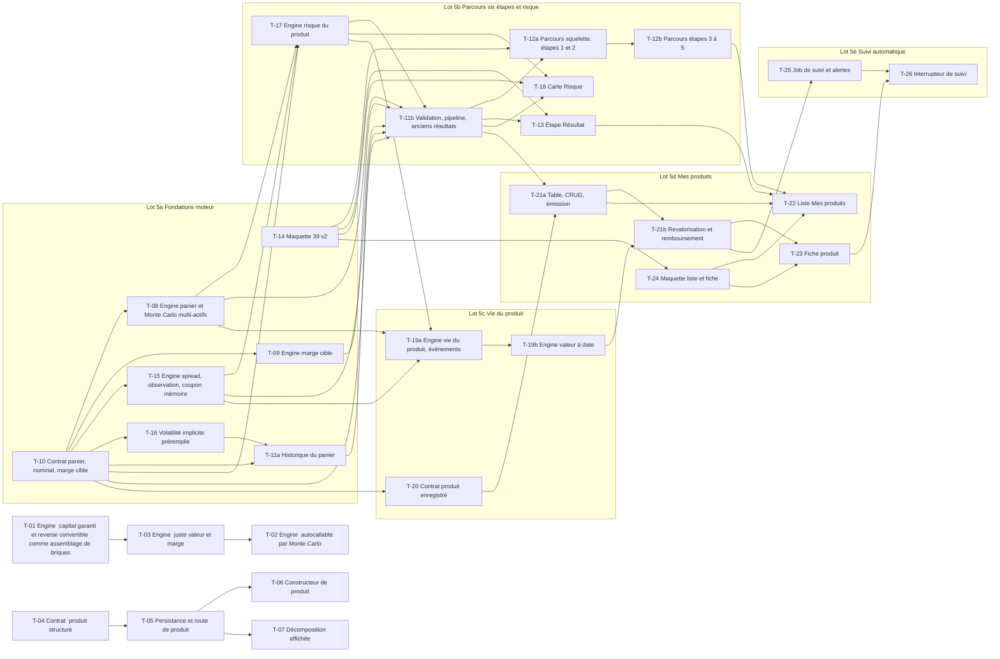

# 21 · Produits structurés : décomposition, juste valeur, marge — Tâches

> Décisions : `US.md`. Échelle de points, statuts et définition de terminé commune : [`roadmap/README.md`](../README.md). Points prévus, réalisés = prévus. Le lot 5 est livré en cinq PR (5a à 5e), une par lot, chacune utilisable seule. T-05 : pas de table ni de routes dédiées (D8), la persistance est celle du pipeline `pricing.*`.

## Synthèse

| Tâche | Lot | Titre | US | Couche | Priorité | Points | Dépend de | Commits |
| --- | --- | --- | --- | --- | --- | --- | --- | --- |
| T-01 | 1 | Engine : capital garanti et reverse convertible comme assemblage de briques | US-01, US-02 | backtest-engine | MUST | 5 | — | `75dec1b` |
| T-02 | 1 | Engine : autocallable par Monte Carlo | US-03 | backtest-engine | MUST | 5 | T-03 | `75dec1b` |
| T-03 | 1 | Engine : juste valeur et marge | US-02, US-03 | backtest-engine | MUST | 3 | T-01 | `75dec1b` |
| T-04 | 2 | Contrat : produit structuré | US-01, US-02, US-03 | contracts | MUST | 3 | — | `0970f3d` |
| T-05 | 3 | Persistance et route de produit | US-01, US-02, US-03 | core-backend | MUST | 5 | T-04 | `4a44cbe` |
| T-06 | 4 | Constructeur de produit | US-01, US-02 | web | MUST | 5 | T-05 | `69be2a1` |
| T-07 | 4 | Décomposition affichée | US-01 | web | MUST | 3 | T-05 | `69be2a1` |
| T-10 | 5a | Contrat : panier, nominal en devise, marge cible | US-04, US-05, US-06 | contracts | MUST | 3 | — | — |
| T-14 | 5a | Maquette 39 v2 : parcours en six étapes (D19) | US-04, US-05, US-06 | design | MUST | 3 | — | — |
| T-08 | 5a | Engine : panier, corrélation et Monte Carlo multi-actifs | US-05, US-06 | backtest-engine | MUST | 5 | T-10 | — |
| T-09 | 5a | Engine : marge cible et prix client déduit | US-04 | backtest-engine | MUST | 5 | T-10 | — |
| T-15 | 5a | Engine : spread de financement, fréquence d'observation et coupon mémoire | US-04, US-07 | backtest-engine | MUST | 5 | T-10 | — |
| T-16 | 5a | Volatilité implicite préremplie par sous-jacent | US-05 | market-service | MUST | 3 | T-10 | — |
| T-11a | 5a | Market-service : historique du panier (volatilités, dividendes, corrélations) | US-05 | market-service | MUST | 3 | T-10, T-16 | — |
| T-17 | 5b | Engine : risque du produit (delta, vega, corrélation, marge nette) | US-08 | backtest-engine | MUST | 5 | T-10, T-08, T-15 | — |
| T-11b | 5b | Core-backend : validation, pipeline et anciens résultats | US-04, US-05, US-06 | core-backend | MUST | 3 | T-08, T-09, T-10, T-15, T-17, T-11a | — |
| T-12a | 5b | Parcours : squelette, résumé, nom, étapes 1 et 2 (besoin, panier) | US-05, US-06 | web | MUST | 3 | T-11b, T-14 | — |
| T-12b | 5b | Parcours : étapes 3 à 5 (payoff, marché, marge) | US-04, US-05, US-06 | web | MUST | 3 | T-12a | — |
| T-13 | 5b | Étape Résultat : décomposition, payoff et corrélations du panier | US-05, US-06 | web | MUST | 3 | T-11b, T-14 | — |
| T-18 | 5b | Étape Résultat : carte Risque | US-08 | web | MUST | 3 | T-11b, T-14, T-17 | — |
| T-20 | 5c | Contrat : produit enregistré, statut et instantanés | US-09, US-10 | contracts | MUST | 3 | T-10 | — |
| T-19a | 5c | Engine : vie du produit, observations, rappel et barrière | US-10 | backtest-engine | MUST | 5 | T-08, T-15, T-17 | — |
| T-19b | 5c | Engine : vie du produit, valeur à date | US-10 | backtest-engine | MUST | 3 | T-19a | — |
| T-24 | 5d | Maquette : liste « Mes produits » et fiche produit | US-09, US-10 | design | MUST | 3 | T-14 | — |
| T-21a | 5d | Core-backend : table produit, CRUD, renommage et émission | US-09 | core-backend | MUST | 5 | T-11b, T-20 | — |
| T-21b | 5d | Core-backend : revalorisation, instantanés et remboursement | US-10 | core-backend | MUST | 5 | T-21a, T-19b | — |
| T-22 | 5d | Liste « Mes produits » et enregistrement depuis le résultat | US-09 | web | MUST | 5 | T-13, T-12b, T-21a, T-24 | — |
| T-23 | 5d | Fiche produit : évolution et vie du contrat | US-10 | web | MUST | 5 | T-21b, T-24 | — |
| T-25 | 5e | Core-backend : job quotidien de suivi et alertes d'événements | US-11 | core-backend | MUST | 5 | T-21b | — |
| T-26 | 5e | Interrupteur de suivi automatique et alertes sur la fiche | US-11 | web | MUST | 2 | T-23, T-25 | — |

**Total** : 117 points — MUST 117, SHOULD 0 (29 livrés, 88 de l'évolution du 2026-11-25 ; 84 avant le découpage en lots, T-11, T-12 et T-21 gagnent chacune 1 à 2 points une fois scindées).

| Lot | Tâches | Points | PR (branche) |
| --- | --- | --- | --- |
| 1. Moteur | T-01 → T-03 | 13 | livré |
| 2. Contrat | T-04 | 3 | livré |
| 3. Service | T-05 | 5 | livré |
| 4. Écrans | T-06 → T-07 | 8 | livré |
| 5a. Fondations moteur | T-10, T-14, T-08, T-09, T-15, T-16, T-11a | 27 | `feat/21a-moteur-panier` |
| 5b. Parcours six étapes et risque | T-17, T-11b, T-12a, T-12b, T-13, T-18 | 20 | `feat/21b-parcours-six-etapes` |
| 5c. Vie du produit | T-20, T-19a, T-19b | 11 | `feat/21c-vie-du-produit` |
| 5d. Mes produits | T-24, T-21a, T-21b, T-22, T-23 | 23 | `feat/21d-mes-produits` |
| 5e. Suivi automatique | T-25, T-26 | 7 | `feat/21e-suivi-automatique` |

**Livraison par lot** : une branche et une PR vers `develop` par lot, ouverte depuis `develop` à jour une fois le lot précédent mergé (lot 5b après 5a, etc.), un commit par étape verte. Un lot est mergeable seul : l'écran existant continue de fonctionner (champs ajoutés optionnels) et `bun run verify` passe. Un lot sans écran (5a, 5c) se prouve par ses tests et, côté route, par `API.md`. Services à redémarrer signalés à chaque PR (contrat Kafka ou migration).

**Chemin critique** (13 points, lots 1 à 4) : T-01 → T-03 → T-02. T-02 : l'autocallable est la tâche la plus lourde en tests ; elle doit reproduire un cas à remboursement certain (test de bord).

**Chemin critique de l'évolution** (33 points) : T-10 → T-08 → T-17 → T-11b → T-21a → T-21b → T-23 → T-26 ; la branche T-17 → T-19a → T-19b → T-21b a la même longueur. La maquette T-14 (3 points) démarre avec T-10 et bloque le web du lot 5b ; T-24 s'écrit pendant le lot 5c.

**Parallélisable** : à l'intérieur du lot 5a, T-10 et T-14 démarrent ensemble ; T-08, T-09, T-15 et T-16 en parallèle après T-10 ; T-11a après T-16. Dans le lot 5b, T-12a, T-13 et T-18 en parallèle après T-11b (si T-14 est faite). Dans le lot 5c, T-20 et T-19a en parallèle. Dans le lot 5d, T-22 et T-23 en parallèle après leurs dépendances. Entre lots : la maquette T-24 s'écrit pendant les lots 5b et 5c.

## Graphe des dépendances

---

## Lot 1 — Moteur

### T-01 · Engine : capital garanti et reverse convertible comme assemblage de briques

- **US** : US-01, US-02 · **Priorité** : MUST · **Points** : 5 · **Dépend de** : — · **Commits** : `75dec1b`
- **Fichiers** : `apps/backtest-engine/engine/structured.ts`, tests

Critères d’acceptation :
- [x] Capital garanti = zéro-coupon (17) + call (18) ; participation = (100 − zéro-coupon) / prix du call.
- [x] Reverse convertible = obligation + vente de put : le coupon couvre la prime.
- [x] Test : la somme des briques égale le prix du produit.

### T-02 · Engine : autocallable par Monte Carlo

- **US** : US-03 · **Priorité** : MUST · **Points** : 5 · **Dépend de** : T-03 · **Commits** : —
- **Fichiers** : `apps/backtest-engine/engine/structured-mc.ts`

Critères d’acceptation :
- [x] Observation annuelle, rappel si sous-jacent ≥ 100 % du niveau initial avec coupon cumulé, barrière de capital 60 % à l'échéance, 5 ans par défaut ; niveaux modifiables (D6).
- [x] Chaque trajectoire donne le flux ; prix = moyenne actualisée.

### T-03 · Engine : juste valeur et marge

- **US** : US-02, US-03 · **Priorité** : MUST · **Points** : 3 · **Dépend de** : T-01 · **Commits** : —
- **Fichiers** : `apps/backtest-engine/engine/structured.ts`

Critères d’acceptation :
- [x] Marge = prix client − juste valeur, en devise et en pourcentage du prix client (D4) ; prix client = nominal à 100 % (D5).
- [x] Le calcul vit ici, pas dans le web.

## Lot 2 — Contrat

### T-04 · Contrat : produit structuré

- **US** : US-01, US-02, US-03 · **Priorité** : MUST · **Points** : 3 · **Dépend de** : — · **Commits** : —
- **Fichiers** : `packages/contracts/src/structured.ts`

Critères d’acceptation :
- [x] Type de produit (`CAPITAL_GUARANTEED`, `REVERSE_CONVERTIBLE`, `AUTOCALLABLE`), paramètres, sortie décomposée.

## Lot 3 — Service

### T-05 · Persistance et route de produit

- **US** : US-01, US-02, US-03 · **Priorité** : MUST · **Points** : 5 · **Dépend de** : T-04 · **Commits** : —
- **Fichiers** : `apps/core-backend/services/structured.service.ts`, `prisma/schema.prisma`, `routes/structured/`

Critères d’acceptation :
- [x] Création et lecture d'un produit ; résultat décomposé stocké.
- [x] Migration additive.

## Lot 4 — Écrans

### T-06 · Constructeur de produit

- **US** : US-01, US-02 · **Priorité** : MUST · **Points** : 5 · **Dépend de** : T-05 · **Commits** : `69be2a1`
- **Fichiers** : `apps/web/src/features/structured/` (nouveau)

Critères d’acceptation :
- [x] Formulaire : type, maturité, sous-jacent ; niveaux de l'autocallable modifiables (D6). Pas de saisie du prix client (D5).
- [x] La participation et la marge sont celles reçues du backend, jamais calculées ici.

### T-07 · Décomposition affichée

- **US** : US-01 · **Priorité** : MUST · **Points** : 3 · **Dépend de** : T-05 · **Commits** : `69be2a1`
- **Fichiers** : `apps/web/src/features/structured/`

Critères d’acceptation :
- [x] Deux lignes : obligation et option, avec leur valeur reçue et une phrase d'explication (glossaire).

## Lot 5a — Fondations moteur

> Branche `feat/21a-moteur-panier`. **Livre** : contrat, moteur de pricing multi-actifs, marge cible, spread, coupon mémoire, volatilité implicite et historique du panier, plus la maquette 39 v2. **Utilisable seul** : aucun écran ne change (champs optionnels, la page livrée continue de fonctionner) ; la preuve est dans les tests des engines et dans les routes de `API.md`. **Redémarrer** : backtest-engine, core-backend.

### T-10 · Contrat : panier, nominal en devise, marge cible

- **US** : US-04, US-05, US-06 · **Priorité** : MUST · **Points** : 3 · **Dépend de** : — · **Commits** : —
- **Fichiers** : `packages/contracts/src/structured.ts`

Critères d’acceptation :
- [ ] Sous-jacents (2 à 5), mode du panier, nominal, marge cible, niveaux en prix ; unités commentées.
- [ ] Champs ajoutés optionnels pour que les résultats déjà stockés restent lisibles.
- [ ] Sorties de risque (delta et vega par sous-jacent, sensibilité à la corrélation, coût de couverture, marge nette) avec unités commentées (D20).

### T-14 · Maquette 39 v2 : parcours en six étapes (D19)

- **US** : US-04, US-05, US-06 · **Priorité** : MUST · **Points** : 3 · **Dépend de** : — · **Commits** : —
- **Fichiers** : Figma, trois cadres de la section de la feature (nouvelles versions)

Critères d’acceptation :
- [ ] Choix courts en `FilterTabs` ; repère « barrière touchée » sur la courbe de la fiche Émis et état « Remboursé » dessiné (D26).
- [ ] Champ « Nom du produit » à l'étape 1 et rappel du nom dans le résumé, renommage sur la fiche ;
- [ ] Six étapes (besoin, panier, payoff, marché, marge, résultat), résumé du produit visible, `InfoHint` sur chaque champ et résultat ; variantes capital garanti, reverse convertible, autocallable à l'étape 3.
- [ ] Écarts à l'état livré listés dans le `README.md`.

### T-08 · Engine : panier, corrélation et Monte Carlo multi-actifs

- **US** : US-05, US-06 · **Priorité** : MUST · **Points** : 5 · **Dépend de** : T-10 · **Commits** : —
- **Fichiers** : `apps/backtest-engine/engine/structured.ts`, `structured-mc.ts`, `basket.ts` (nouveau), tests

Critères d’acceptation :
- [ ] Trajectoires corrélées par Cholesky, graine 42 ; agrégat worst-of / best-of / moyenne.
- [ ] Un panier à un seul sous-jacent redonne le prix actuel (test de non-régression).
- [ ] Niveaux en prix et nominal en devise ramenés en % du niveau initial (D14).

### T-09 · Engine : marge cible et prix client déduit

- **US** : US-04 · **Priorité** : MUST · **Points** : 5 · **Dépend de** : T-10 · **Commits** : —
- **Fichiers** : `apps/backtest-engine/engine/structured.ts`, tests

Critères d’acceptation :
- [ ] Capital garanti : participation = budget d'option ÷ prix du call, budget = nominal − zéro-coupon − marge cible.
- [ ] Reverse convertible et autocallable : coupon résolu pour que prix client − juste valeur = marge cible (graine fixe, reproductible).
- [ ] Marge inatteignable : erreur explicite, jamais un coupon négatif.

### T-15 · Engine : spread de financement, fréquence d'observation et coupon mémoire

- **US** : US-04, US-07 · **Priorité** : MUST · **Points** : 5 · **Dépend de** : T-10 · **Commits** : —
- **Fichiers** : `apps/backtest-engine/engine/structured.ts`, `structured-mc.ts`, tests

Critères d’acceptation :
- [ ] Zéro-coupon escompté à taux + spread (D17) ; spread 0 redonne le prix actuel.
- [ ] Observation annuelle, semestrielle ou trimestrielle, coupon mémoire, période de non-rappel (D18).

### T-16 · Volatilité implicite préremplie par sous-jacent

- **US** : US-05 · **Priorité** : MUST · **Points** : 3 · **Dépend de** : T-10 · **Commits** : —
- **Fichiers** : `apps/market-service/` (repository, interfaces), `packages/contracts/src/market.ts`, `apps/market-service/API.md`, tests

Critères d’acceptation :
- [ ] `GET /api/market/option-inputs` renvoie en plus `impliedVolatility` (D29) : volatilité implicite publiée par Yahoo pour l'option la plus proche du cours, échéance à 30 jours au moins ; `null` sans chaîne exploitable, l'historique reste le repli côté web (D16).
- [ ] Champ ajouté optionnel au contrat ; unité commentée ; `API.md` à jour dans le même diff.

### T-11a · Market-service : historique du panier (volatilités, dividendes, corrélations)

- **US** : US-05 · **Priorité** : MUST · **Points** : 3 · **Dépend de** : T-10, T-16 · **Commits** : —
- **Fichiers** : `apps/market-service/` (route, controller, service, repository), `packages/utils/src/stats.ts` (`returnsCorrelation`), `packages/contracts/src/market.ts`, `apps/market-service/API.md`, `apps/core-backend` (proxy, `API.md` si la route y figure), tests

Critères d’acceptation :
- [ ] `GET /api/market/basket-inputs?symbols=A,B,C` (2 à 5 symboles) renvoie par symbole le cours, la volatilité et le dividende de `option-inputs`, et la matrice de corrélations des rendements journaliers sur 1 an, alignés sur les dates communes (D13, D29) ; unités commentées.
- [ ] Un symbole inconnu ou sans historique suffisant : erreur explicite, jamais une corrélation inventée. Calcul pur `returnsCorrelation` testé dans `packages/utils`.
- [ ] Relayée par le proxy de core-backend ; `API.md` à jour dans le même diff.

## Lot 5b — Parcours six étapes et risque

> Branche `feat/21b-parcours-six-etapes`, après le merge du lot 5a. **Livre** : le constructeur en six étapes avec panier, marge cible et carte Risque. **Utilisable seul** : l'utilisateur structure un panier du besoin au résultat ; « Enregistrer » n'existe pas encore (lot 5d), le résultat reste dans l'historique des calculs (D8). **Redémarrer** : backtest-engine, core-backend. **Avant le code web** : T-14 mergée dans Figma (`apps/web/AGENTS.md`).

### T-17 · Engine : risque du produit (delta, vega, corrélation, marge nette)

- **US** : US-08 · **Priorité** : MUST · **Points** : 5 · **Dépend de** : T-10, T-08, T-15 · **Commits** : —
- **Fichiers** : `apps/backtest-engine/engine/structured-risk.ts` (nouveau), tests

Critères d’acceptation :
- [ ] Delta (devise) et vega (par point) par sous-jacent, sensibilité à la corrélation (+ 10 points), par bump and reprice à tirages identiques (D20).
- [ ] Marge nette = marge − coût de couverture saisi ; test : sur un capital garanti à un sous-jacent, le delta est proche de celui de `optionGreeks` × participation.

### T-11b · Core-backend : validation, pipeline et anciens résultats

- **US** : US-04, US-05, US-06 · **Priorité** : MUST · **Points** : 3 · **Dépend de** : T-08, T-09, T-10, T-15, T-17, T-11a · **Commits** : —
- **Fichiers** : `apps/core-backend/services/`, `API.md`, `prisma/schema.prisma` si besoin

Critères d’acceptation :
- [ ] Validation de l'entrée (2 à 5 sous-jacents, même devise, marge cible, niveaux) ; publication sur le pipeline `pricing.*` (D15).
- [ ] Anciens résultats `STRUCTURED` toujours affichables.

### T-12a · Parcours : squelette, résumé, nom, étapes 1 et 2 (besoin, panier)

- **US** : US-05, US-06 · **Priorité** : MUST · **Points** : 3 · **Dépend de** : T-11b, T-14 · **Commits** : —
- **Fichiers** : `apps/web/src/features/structured/`, `messages/`, `COMPONENTS.md`

Critères d’acceptation :
- [ ] Navigation libre entre les six étapes, résumé du produit toujours visible (D19) ; champ « Nom du produit » à l'étape 1, prérempli (D22) ; aucune valeur métier calculée côté web.
- [ ] Étape 1 : besoin du client, propose un type de produit ; étape 2 : sous-jacents (`SymbolPicker`) et mode du panier, corrélations modifiables avec pastille « modifiée » (D13).
- [ ] `InfoHint` par champ ; glossaire FR et EN : mode du panier, corrélation.

### T-12b · Parcours : étapes 3 à 5 (payoff, marché, marge)

- **US** : US-04, US-05, US-06 · **Priorité** : MUST · **Points** : 3 · **Dépend de** : T-12a · **Commits** : —
- **Fichiers** : `apps/web/src/features/structured/`, `messages/`, `COMPONENTS.md`

Critères d’acceptation :
- [ ] Étape 3 : payoff et réglages des trois produits, nominal en devise et niveaux en prix (D14) ; étape 4 : volatilité (implicite préremplie), spread de financement, coupon mémoire ; étape 5 : marge cible.
- [ ] `InfoHint` par champ ; glossaire FR et EN : marge cible, spread de financement, coupon mémoire, volatilité implicite.

### T-13 · Étape Résultat : décomposition, payoff et corrélations du panier

- **US** : US-05, US-06 · **Priorité** : MUST · **Points** : 3 · **Dépend de** : T-11b, T-14 · **Commits** : —
- **Fichiers** : `apps/web/src/features/structured/`

Critères d’acceptation :
- [ ] Étape 6 : `InfoHint` par résultat ; prix client et condition offerte affichés comme sorties ; matrice de corrélations en lecture.
- [ ] `<Dash />` pour un résultat antérieur sans ces champs.

### T-18 · Étape Résultat : carte Risque

- **US** : US-08 · **Priorité** : MUST · **Points** : 3 · **Dépend de** : T-11b, T-14, T-17 · **Commits** : —
- **Fichiers** : `apps/web/src/features/structured/`, `COMPONENTS.md`, `messages/`

Critères d’acceptation :
- [ ] Carte construite avec `StatCard`, tableau et `InfoHint` comme `GreeksCard` (D21) ; valeurs reçues, rien de calculé côté web.
- [ ] `<Dash />` pour un résultat antérieur sans risque.

## Lot 5c — Vie du produit

> Branche `feat/21c-vie-du-produit`, après le lot 5b (ou en parallèle du 5b, la dépendance réelle étant T-17). **Livre** : le contrat du produit enregistré et le moteur qui rejoue la vie d'un produit. **Utilisable seul** : aucun écran, aucune route ; deux briques pures prouvées par leurs tests, que le lot 5d branche. **Redémarrer** : backtest-engine.

### T-20 · Contrat : produit enregistré, statut et instantanés

- **US** : US-09, US-10 · **Priorité** : MUST · **Points** : 3 · **Dépend de** : T-10 · **Commits** : —
- **Fichiers** : `packages/contracts/src/structured.ts`

Critères d’acceptation :
- [ ] DTO du produit (nom de 1 à 80 caractères choisi par l'utilisateur, statut `DRAFT`, `ISSUED` ou `REDEEMED` (D26), date d'émission, paramètres, dernier résultat), instantané daté, événements du contrat ; unités commentées.

### T-19a · Engine : vie du produit, observations, rappel et barrière

- **US** : US-10 · **Priorité** : MUST · **Points** : 5 · **Dépend de** : T-08, T-15, T-17 · **Commits** : —
- **Fichiers** : `apps/backtest-engine/engine/structured-life.ts` (nouveau), tests

Critères d’acceptation :
- [ ] Rejoue un produit depuis la date d'émission avec les cours reçus : observations passées, rappel, barrière touchée, flux déjà payés (D24).
- [ ] Pur, sans I/O ; tests : rappel au premier jour d'observation, barrière touchée puis remontée.

### T-19b · Engine : vie du produit, valeur à date

- **US** : US-10 · **Priorité** : MUST · **Points** : 3 · **Dépend de** : T-19a · **Commits** : —
- **Fichiers** : `apps/backtest-engine/engine/structured-life.ts`, tests

Critères d’acceptation :
- [ ] Valeur à date = flux acquis + juste valeur restante (maturité restante, cours à date) ; gain à date ; produit non encore observé = pricing actuel (D24).
- [ ] Tests : produit arrivé à l'échéance, produit remboursé (valeur figée au rappel).

## Lot 5d — Mes produits

> Branche `feat/21d-mes-produits`, après les lots 5b et 5c. **Livre** : enregistrer, lister, émettre, revaloriser et suivre un produit. **Utilisable seul** : sans suivi automatique, la revalorisation se lance à la main. **Redémarrer** : core-backend (migration additive), backtest-engine. **Avant le code web** : T-24 faite dans Figma.

### T-24 · Maquette : liste « Mes produits » et fiche produit

- **US** : US-09, US-10 · **Priorité** : MUST · **Points** : 3 · **Dépend de** : T-14 · **Commits** : —
- **Fichiers** : Figma, section de la feature

Critères d’acceptation :
- [ ] Liste (statuts, actions), fiche (statistiques, courbe d'évolution, chronologie), états brouillon et émis, depuis les cadres 11 (liste des backtests), 13 (résultat) et 35 à 38.

### T-21a · Core-backend : table produit, CRUD, renommage et émission

- **US** : US-09 · **Priorité** : MUST · **Points** : 5 · **Dépend de** : T-11b, T-20 · **Commits** : —
- **Fichiers** : `prisma/schema.prisma` (migration additive), `repositories/`, `services/structured-product.service.ts`, `routes/`, `API.md`, tests

Critères d’acceptation :
- [ ] Créer, lister, lire, modifier un brouillon, supprimer, renommer (un produit émis peut être renommé : le nom n'est pas un terme du contrat) ; propriétaire = utilisateur connecté (D22).
- [ ] « Émettre » fige les termes, une seule fois (garde par statut) ; modifier un `ISSUED` refusé (D23).
- [ ] Aucune route ne lit ou n'écrit le produit d'un autre utilisateur.

### T-21b · Core-backend : revalorisation, instantanés et remboursement

- **US** : US-10 · **Priorité** : MUST · **Points** : 5 · **Dépend de** : T-21a, T-19b · **Commits** : —
- **Fichiers** : `repositories/`, `services/structured-product.service.ts`, `API.md`, tests

Critères d’acceptation :
- [ ] Revalorisation : publie sur `pricing.*` avec l'identifiant du produit ; le consommateur attache l'instantané, idempotent (D24).
- [ ] Au plus 90 instantanés par produit, les plus anciens purgés à l'insertion (D26) ; un produit supprimé efface ses instantanés.
- [ ] Un rappel détecté par la revalorisation passe le produit `ISSUED` en `REDEEMED` (transition gardée par statut), coupe le suivi automatique et notifie une fois ; un `REDEEMED` ne se revalorise plus (D26).

### T-22 · Liste « Mes produits » et enregistrement depuis le résultat

- **US** : US-09 · **Priorité** : MUST · **Points** : 5 · **Dépend de** : T-13, T-12b, T-21a, T-24 · **Commits** : —
- **Fichiers** : `apps/web/src/features/structured/`, `COMPONENTS.md`, `messages/`

Critères d’acceptation :
- [ ] « Enregistrer » à l'étape Résultat ; liste avec statut, juste valeur, marge, date ; ouvrir, dupliquer, supprimer avec confirmation ; composants des listes existantes réutilisés (D21).
- [ ] Un brouillon rouvert reprend le parcours en six étapes ; « Émettre » avec confirmation.

### T-23 · Fiche produit : évolution et vie du contrat

- **US** : US-10 · **Priorité** : MUST · **Points** : 5 · **Dépend de** : T-21b, T-24 · **Commits** : —
- **Fichiers** : `apps/web/src/features/structured/`, `COMPONENTS.md`, `messages/`

Critères d’acceptation :
- [ ] Courbe des instantanés (juste valeur, delta) avec `ChartContainer`, bouton « Revaloriser », chronologie des observations (rappel, barrière touchée, flux payés), `InfoHint` par résultat.
- [ ] Rien calculé côté web ; `<Dash />` pour un produit sans instantané.
- [ ] État « Remboursé » : badge, courbe arrêtée, pas de bouton Revaloriser.

## Lot 5e — Suivi automatique

> Branche `feat/21e-suivi-automatique`, après le lot 5d. **Livre** : revalorisation quotidienne et alertes d'événements. **Utilisable seul** : interrupteur par produit, désactivé par défaut. **Redémarrer** : core-backend (champ `autoTrack`, additif) et notification-service si de nouveaux types sont ajoutés.

### T-25 · Core-backend : job quotidien de suivi et alertes d'événements

- **US** : US-11 · **Priorité** : MUST · **Points** : 5 · **Dépend de** : T-21b · **Commits** : —
- **Fichiers** : `apps/core-backend/`, `prisma/schema.prisma` (champ `autoTrack`, additif), `API.md`, tests

Critères d’acceptation :
- [ ] Un job quotidien après la clôture publie la revalorisation de chaque produit `ISSUED` suivi, au plus une fois par jour (garde par date) ; `env.ts` porte l'heure et le plafond par utilisateur (D25).
- [ ] Un événement du contrat publie `notification.requested` avec une `dedupKey` par produit et par événement ; rejouer le job ne duplique pas la notification.
- [ ] Un produit supprimé ou arrivé à échéance sort du suivi.

### T-26 · Interrupteur de suivi automatique et alertes sur la fiche

- **US** : US-11 · **Priorité** : MUST · **Points** : 2 · **Dépend de** : T-23, T-25 · **Commits** : —
- **Fichiers** : `apps/web/src/features/structured/`, `COMPONENTS.md`, `messages/`

Critères d’acceptation :
- [ ] Interrupteur sur la fiche d'un produit émis (composant existant, `InfoHint`), plafond atteint signalé par l'erreur de l'API.
- [ ] Types de notification d'événement ajoutés aux dictionnaires FR et EN.
