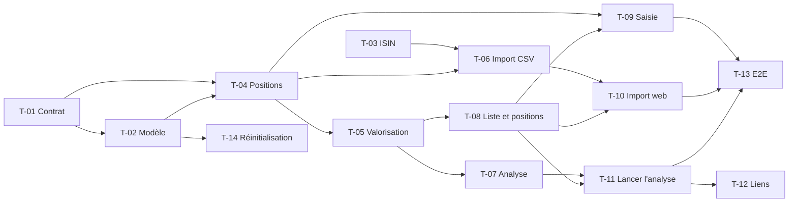

# 27 · Portefeuille réel : positions, import et analyse — Tâches

> Décisions : `US.md`. Échelle de points, statuts et définition de terminé commune : [`roadmap/README.md`](../README.md). Points prévus.

## Synthèse

| Tâche | Titre | US | Couche | Priorité | Points | Dépend de | Commits |
| --- | --- | --- | --- | --- | --- | --- | --- |
| T-01 | Contrat : position, import, codes d'erreur | US-01 | contracts | MUST | 3 | — | — |
| T-02 | Modèle `PortfolioPosition` et `Backtest.portfolioId` | US-01 | core-backend | MUST | 3 | T-01 | — |
| T-03 | Résolution d'un ISIN en symbole | US-02 | market-service | MUST | 3 | — | — |
| T-04 | Positions : repository, service, routes et `API.md` | US-01 | core-backend | MUST | 5 | T-01, T-02 | — |
| T-05 | Valorisation, poids au pourcent et plus-value | US-03 | core-backend | MUST | 5 | T-04 | — |
| T-06 | Import CSV : analyse, rejets et rejeu | US-02 | core-backend | MUST | 5 | T-03, T-04 | — |
| T-07 | Analyse : création du backtest depuis le portefeuille | US-04 | core-backend | MUST | 5 | T-05 | — |
| T-08 | Web : liste des portefeuilles et page des positions | US-03 | web | MUST | 5 | T-05 | — |
| T-09 | Web : ajout, modification et suppression d'une position | US-01 | web | MUST | 3 | T-04, T-08 | — |
| T-10 | Web : import d'un relevé et rapport de rejets | US-02 | web | MUST | 3 | T-06, T-08 | — |
| T-11 | Web : lancer l'analyse et suivre son état | US-04 | web | MUST | 3 | T-07, T-08 | — |
| T-12 | Web : liens vers Risque et Projection de la dernière analyse | US-05 | web | SHOULD | 3 | T-11 | — |
| T-13 | E2E : saisie, import et analyse d'un portefeuille | US-01, US-02, US-04 | web | MUST | 3 | T-09, T-10, T-11 | — |
| T-14 | Réinitialisation des données : positions supprimées | US-01 | core-backend | MUST | 1 | T-02 | — |

**Total** : 50 points — MUST 47, SHOULD 3.

| Lot | Tâches | Points |
| --- | --- | --- |
| 1. Positions et valorisation (backend) | T-01 → T-06 | 24 |
| 2. Écrans | T-08 → T-10 | 11 |
| 3. Analyse | T-07, T-11, T-12 | 11 |
| 4. Tests et finitions | T-13 → T-14 | 4 |

**Chemin critique** (27 points) : T-01 → T-02 → T-04 → T-05 → T-07 → T-11 → T-13. La tâche la plus risquée est T-03 (un ISIN de PEA se résout-il en symbole Yahoo ?) : la commencer en premier, en parallèle du chemin critique, car son résultat conditionne la forme de l'import (D3).

**Parallélisable** : T-03 avec T-01 et T-02 ; T-08 avec T-06 et T-07 ; T-14 dès T-02.

## Graphe des dépendances

---

## Lot 1 — Positions et valorisation (backend)

### T-01 · Contrat : position, import, codes d'erreur

- **US** : US-01 · **Priorité** : MUST · **Points** : 3 · **Dépend de** : — · **Commits** : —
- **Fichiers** : `packages/contracts/src/portfolio.ts` (nouveau), `packages/contracts/src/index.ts`, `packages/contracts/src/errors.ts`

Critères d'acceptation :
- [ ] `positionInputSchema` (symbole, quantité > 0, prix de revient ≥ 0 optionnel) et `positionSchema` (avec `source`, `isin`, `updatedAt`), `POSITION_SOURCES` (`MANUAL`, `IMPORT`), `MAX_POSITIONS` (50), dérivés de zod.
- [ ] `positionViewSchema` : valeur EUR, poids (ratio), plus-value (montant EUR, ratio) ou `null`, dernier cours et sa date ; chaque champ numérique documente son unité en commentaire.
- [ ] Schémas de résultat d'import : lignes importées, lignes rejetées (numéro, motif).
- [ ] Codes d'erreur ajoutés à `API_ERROR_CODES` (position en double, limite de positions, import invalide) ; clés FR et EN dans `messages/`.

### T-02 · Modèle `PortfolioPosition` et `Backtest.portfolioId`

- **US** : US-01 · **Priorité** : MUST · **Points** : 3 · **Dépend de** : T-01 · **Commits** : —
- **Fichiers** : `apps/core-backend/prisma/schema.prisma`, `apps/core-backend/prisma/migrations/`

Critères d'acceptation :
- [ ] `PortfolioPosition` : `portfolioId` (`onDelete: Cascade`), `symbol`, `quantity` et `costBasis` en `Decimal`, `isin` nullable, `source`, `updatedAt`, unique (`portfolioId`, `symbol`).
- [ ] `Backtest.portfolioId` nullable, `onDelete: SetNull`, avec index.
- [ ] La migration s'applique sur une base existante sans toucher aux backtests en place.
- [ ] Test de repository sur `trading_test` : la suppression d'un portefeuille supprime ses positions et laisse les backtests liés.

### T-03 · Résolution d'un ISIN en symbole

- **US** : US-02 · **Priorité** : MUST · **Points** : 3 · **Dépend de** : — · **Commits** : —
- **Fichiers** : `apps/market-service/` (route ou service de recherche), `apps/market-service/API.md`, `apps/web/e2e/fake-market.ts`

Critères d'acceptation :
- [ ] Vérification faite sur trois ETF de PEA connus : le résultat (symbole trouvé ou non) est écrit dans `US.md`, D3.
- [ ] Si la recherche par ISIN fonctionne : une fonction de résolution renvoie un symbole ou `null`, jamais une approximation.
- [ ] Si elle ne fonctionne pas : D3 est mise à jour (l'import exige le symbole) et le choix est signalé à l'utilisateur avant T-06.
- [ ] Le faux market-service des E2E répond pour les ISIN de test.

### T-04 · Positions : repository, service, routes et `API.md`

- **US** : US-01 · **Priorité** : MUST · **Points** : 5 · **Dépend de** : T-01, T-02 · **Commits** : —
- **Fichiers** : `apps/core-backend/repositories/portfolio.repository.ts`, `services/portfolio.service.ts`, `controller/portfolio.controller.ts`, `routes/`, `API.md`, `test/`

Critères d'acceptation :
- [ ] Routes d'ajout, de modification et de suppression d'une position, sous un portefeuille de l'utilisateur ; un portefeuille d'un autre utilisateur répond `404`.
- [ ] Règles dans le service : doublon de symbole refusé, limite de 50 positions, aucune logique métier dans le controller ni le repository.
- [ ] Tests : service avec faux repository, routes avec `startApp`, repository sur `trading_test`.
- [ ] Entrées `API.md` pour chaque route (gabarit du catalogue).

### T-05 · Valorisation, poids au pourcent et plus-value

- **US** : US-03 · **Priorité** : MUST · **Points** : 5 · **Dépend de** : T-04 · **Commits** : —
- **Fichiers** : `apps/core-backend/services/portfolio.valuation.ts` (nouveau), `services/portfolio.service.ts`, `test/portfolio.valuation.test.ts`, `API.md`

Critères d'acceptation :
- [ ] La lecture d'un portefeuille renvoie, par position : valeur EUR, poids, plus-value ; et la valeur totale, avec le `MarketClient` et le change de la feature 11.
- [ ] Poids au pourcent par la méthode du plus fort reste, 1 % minimum par position, somme exactement 1 (cas testés : 3 ETF, une position très petite, une seule position, 50 positions).
- [ ] Un actif sans cours donne une position marquée indisponible, exclue de la valeur totale, sans faire échouer la lecture.
- [ ] Un prix de revient absent donne une plus-value `null`.
- [ ] Les tests couvrent les arrondis et les cas limites ; aucun calcul n'est fait côté web.

### T-06 · Import CSV : analyse, rejets et rejeu

- **US** : US-02 · **Priorité** : MUST · **Points** : 5 · **Dépend de** : T-03, T-04 · **Commits** : —
- **Fichiers** : `apps/core-backend/services/portfolio.import.ts` (nouveau), `controller/portfolio.controller.ts`, `routes/`, `API.md`, `test/portfolio.import.test.ts`

Critères d'acceptation :
- [ ] Le web envoie le texte du fichier ; l'API le valide avec `zod` et analyse les colonnes (ISIN ou symbole, quantité, prix de revient).
- [ ] Une ligne invalide est rejetée avec son numéro et un motif ; les autres sont importées en une transaction.
- [ ] Au-delà de 50 positions, ou pour un contenu qui n'est pas du CSV, le fichier est refusé en bloc.
- [ ] Rejouer le même fichier produit le même état (mise à jour par symbole, pas de doublon).
- [ ] Séparateurs `;` et `,` et décimales à virgule acceptés (relevés français), testés.

## Lot 2 — Écrans

### T-08 · Web : liste des portefeuilles et page des positions

- **US** : US-03 · **Priorité** : MUST · **Points** : 5 · **Dépend de** : T-05 · **Commits** : —
- **Fichiers** : `apps/web/src/features/portfolio/` (nouveau : écrans, `api.ts`, `hook.ts`, `column.tsx`, `COMPONENTS.md`), `app/`, `constants/sidebar.tsx`, `constants/glossary.ts`, `messages/fr.json`, `messages/en.json`, `COMPONENTS.md`

Critères d'acceptation :
- [ ] Maquettes `47` et `47.1` dessinées et validées avant le code ; entrée de sidebar ajoutée à `constants/sidebar.tsx` (source unique de la navigation).
- [ ] Liste des portefeuilles, page d'un portefeuille avec tableau des positions (valeur, poids, plus-value, `<Dash />` si inconnue).
- [ ] Primitives shadcn, textes dans `messages/`, formatters de `lib/format.ts`, `fetch` dans `api.ts`.
- [ ] `InfoHint` et entrées `glossary.<clé>` en FR et EN pour valeur, poids et plus-value.
- [ ] Test du hook et du composant (`test/render.tsx`).

### T-09 · Web : ajout, modification et suppression d'une position

- **US** : US-01 · **Priorité** : MUST · **Points** : 3 · **Dépend de** : T-04, T-08 · **Commits** : —
- **Fichiers** : `apps/web/src/features/portfolio/` (formulaire, `schema.ts`), `COMPONENTS.md`

Critères d'acceptation :
- [ ] Maquette `47.2` validée avant le code.
- [ ] Le sélecteur de symboles existant est réutilisé ; le schéma de formulaire est dérivé du contrat.
- [ ] Erreurs d'API (doublon, limite) affichées avec les messages traduits.
- [ ] Test du formulaire.

### T-10 · Web : import d'un relevé et rapport de rejets

- **US** : US-02 · **Priorité** : MUST · **Points** : 3 · **Dépend de** : T-06, T-08 · **Commits** : —
- **Fichiers** : `apps/web/src/features/portfolio/` (dialog d'import), `COMPONENTS.md`

Critères d'acceptation :
- [ ] Maquette `47.3` validée avant le code.
- [ ] Lecture du fichier dans le navigateur, envoi du texte, affichage du nombre de lignes importées et de la liste des rejets (numéro, motif).
- [ ] Un fichier refusé en bloc affiche le message de l'API.
- [ ] Test du dialog avec un rapport mixte (lignes valides et rejetées).

## Lot 3 — Analyse

### T-07 · Analyse : création du backtest depuis le portefeuille

- **US** : US-04 · **Priorité** : MUST · **Points** : 5 · **Dépend de** : T-05 · **Commits** : —
- **Fichiers** : `apps/core-backend/services/portfolio.service.ts`, `services/backtest.service.ts`, `controller/portfolio.controller.ts`, `routes/`, `API.md`, `test/`

Critères d'acceptation :
- [ ] `POST /api/portfolio/:id/analysis` (période 1, 3, 5 ou 10 ans) crée un backtest conforme à D5 et publie `backtest.requested`, en réutilisant la création de `BacktestService` (aucune règle recopiée).
- [ ] Les allocations passent `allocationsSchema` (poids entiers en pourcent, somme = 1) ; `Backtest.portfolioId` est renseigné.
- [ ] Portefeuille vide ou sans cours exploitable : erreur explicite, aucun backtest créé.
- [ ] `GET` d'un portefeuille renvoie l'identifiant et l'état de sa dernière analyse (D6).
- [ ] Tests : service avec faux repository et faux éditeur, route avec `startApp`.

### T-11 · Web : lancer l'analyse et suivre son état

- **US** : US-04 · **Priorité** : MUST · **Points** : 3 · **Dépend de** : T-07, T-08 · **Commits** : —
- **Fichiers** : `apps/web/src/features/portfolio/`, `messages/`, `COMPONENTS.md`

Critères d'acceptation :
- [ ] Choix de la période (1, 3, 5, 10 ans), bouton « Analyser », état de la dernière analyse (en cours, terminée, indisponible).
- [ ] Texte visible : poids actuels appliqués à l'historique ; simulation, pas un conseil.
- [ ] Bouton désactivé avec explication si le portefeuille est vide.
- [ ] Test du composant.

### T-12 · Web : liens vers Risque et Projection de la dernière analyse

- **US** : US-05 · **Priorité** : SHOULD · **Points** : 3 · **Dépend de** : T-11 · **Commits** : —
- **Fichiers** : `apps/web/src/features/portfolio/`, `apps/web/src/features/risk/`, `apps/web/src/features/projection/`

Critères d'acceptation :
- [ ] Les liens ouvrent les pages Risque et Projection avec le backtest de la dernière analyse déjà sélectionné.
- [ ] Sans analyse, les liens sont absents et le bouton d'analyse est proposé.
- [ ] Point d'entrée dessiné dans la copie Figma de l'écran modifié avant le code.

## Lot 4 — Tests et finitions

### T-13 · E2E : saisie, import et analyse d'un portefeuille

- **US** : US-01, US-02, US-04 · **Priorité** : MUST · **Points** : 3 · **Dépend de** : T-09, T-10, T-11 · **Commits** : —
- **Fichiers** : `apps/web/e2e/portfolio.e2e.ts` (nouveau), `apps/web/e2e/fake-market.ts`

Critères d'acceptation :
- [ ] Parcours : créer un portefeuille, ajouter une position, importer un CSV avec une ligne rejetée, lancer l'analyse et voir le risque et la projection arriver.
- [ ] Les E2E vérifient que chaque étape apparaît à l'écran, pas les chiffres exacts.
- [ ] `bun run e2e` passe.

### T-14 · Réinitialisation des données : positions supprimées

- **US** : US-01 · **Priorité** : MUST · **Points** : 1 · **Dépend de** : T-02 · **Commits** : —
- **Fichiers** : `apps/core-backend/services/account.service.ts`, `apps/core-backend/test/`

Critères d'acceptation :
- [ ] `POST /api/account/reset` laisse zéro position et zéro portefeuille pour l'utilisateur (test sur `trading_test`).
