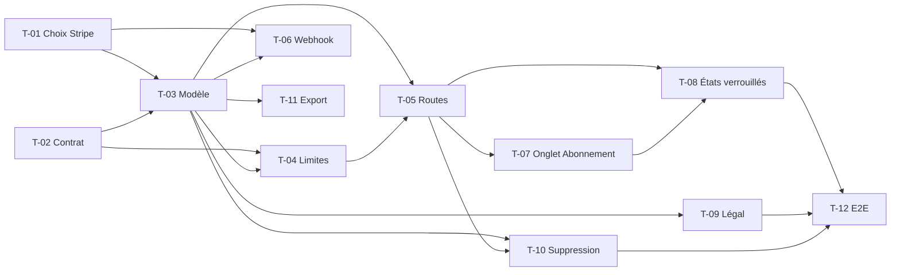

# 28 · Offres et abonnement : plans, facturation et cadre légal — Tâches

> Décisions : `US.md`. Échelle de points, statuts et définition de terminé commune : [`roadmap/README.md`](../README.md). Points prévus.

## Synthèse

| Tâche | Titre | US | Couche | Priorité | Points | Dépend de | Commits |
| --- | --- | --- | --- | --- | --- | --- | --- |
| T-01 | Choix de l'intégration Stripe (plugin better-auth ou SDK) | US-03 | core-backend | MUST | 2 | — | — |
| T-02 | Contrat : plans, limites, vue du plan, code `PLAN_LIMIT` | US-01 | contracts | MUST | 3 | — | — |
| T-03 | Modèle : plan, abonnement, CGU, événements Stripe | US-03, US-06 | core-backend | MUST | 3 | T-01, T-02 | — |
| T-04 | Service de plan : limites appliquées côté serveur | US-02 | core-backend | MUST | 5 | T-02, T-03 | — |
| T-05 | Routes : plan, paiement et portail client | US-01, US-03, US-04 | core-backend | MUST | 5 | T-03, T-04 | — |
| T-06 | Webhook Stripe signé et idempotent | US-05 | core-backend | MUST | 5 | T-01, T-03 | — |
| T-07 | Web : onglet Abonnement | US-01, US-03, US-04 | web | MUST | 5 | T-05 | — |
| T-08 | Web : états verrouillés et limite atteinte | US-02 | web | MUST | 3 | T-05, T-07 | — |
| T-09 | Web : mention « simulation », pages légales, case CGU | US-06 | web | MUST | 3 | T-03 | — |
| T-10 | Suppression de compte | US-07 | core-backend | MUST | 5 | T-03, T-05 | — |
| T-11 | Export des données en JSON | US-08 | core-backend | SHOULD | 3 | T-03 | — |
| T-12 | E2E : limite, abonnement, CGU et suppression de compte | US-02, US-03, US-06, US-07 | web | MUST | 3 | T-08, T-09, T-10 | — |

**Total** : 45 points — MUST 42, SHOULD 3.

| Lot | Tâches | Points |
| --- | --- | --- |
| 1. Intégration et droits | T-01 → T-04 | 13 |
| 2. Facturation | T-05 → T-06 | 10 |
| 3. Écrans | T-07 → T-09 | 11 |
| 4. Données personnelles | T-10 → T-11 | 8 |
| 5. Tests | T-12 | 3 |

**Chemin critique** (26 points) : T-01 → T-03 → T-04 → T-05 → T-07 → T-08 → T-12. Les deux tâches les plus risquées sont T-01 (le plugin Stripe de better-auth couvre-t-il le besoin ?) et T-06 (webhooks rejoués et désordonnés) : les commencer tôt.

**Parallélisable** : T-01 avec T-02 ; T-06 avec T-04 et T-05 ; T-09 dès T-03 ; T-11 dès T-03.

## Graphe des dépendances

---

## Lot 1 — Intégration et droits

### T-01 · Choix de l'intégration Stripe (plugin better-auth ou SDK)

- **US** : US-03 · **Priorité** : MUST · **Points** : 2 · **Dépend de** : — · **Commits** : —
- **Fichiers** : `roadmap/28-offres-et-abonnement/US.md` (D5), `apps/core-backend/package.json`

Critères d'acceptation :
- [ ] Lecture du code et de la documentation du plugin Stripe de better-auth (version compatible avec celle installée) : modèle d'abonnement, webhooks, idempotence, gestion du portail.
- [ ] D5 mise à jour avec le choix et la raison (plugin ou SDK `stripe` direct) ; une seule dépendance ajoutée.
- [ ] Mode test de Stripe utilisable en local (clés dans `env.ts`, validées par `zod`, jamais dans le dépôt).

### T-02 · Contrat : plans, limites, vue du plan, code `PLAN_LIMIT`

- **US** : US-01 · **Priorité** : MUST · **Points** : 3 · **Dépend de** : — · **Commits** : —
- **Fichiers** : `packages/contracts/src/plan.ts` (nouveau), `packages/contracts/src/index.ts`, `packages/contracts/src/errors.ts`

Critères d'acceptation :
- [ ] `PLANS` (`FREE`, `PRO`), `PLAN_LIMITS` par plan (portefeuilles, backtests, horizon de projection en années), chaque champ avec son unité en commentaire.
- [ ] `planViewSchema` : plan, limites, usage, état de l'abonnement ; types dérivés de zod.
- [ ] `PLAN_LIMIT` dans `API_ERROR_CODES` ; clés FR et EN dans `messages/`.
- [ ] Valeurs de D1 écrites une seule fois, dans cette constante.

### T-03 · Modèle : plan, abonnement, CGU, événements Stripe

- **US** : US-03, US-06 · **Priorité** : MUST · **Points** : 3 · **Dépend de** : T-01, T-02 · **Commits** : —
- **Fichiers** : `apps/core-backend/prisma/schema.prisma`, `apps/core-backend/prisma/migrations/`

Critères d'acceptation :
- [ ] `User.plan` (défaut `FREE`), identifiants et état d'abonnement Stripe nullables, `termsAcceptedAt` nullable.
- [ ] Table des événements Stripe traités (identifiant d'événement unique).
- [ ] La migration laisse tous les comptes existants en `FREE` (D7).
- [ ] Test de repository sur `trading_test`.

### T-04 · Service de plan : limites appliquées côté serveur

- **US** : US-02 · **Priorité** : MUST · **Points** : 5 · **Dépend de** : T-02, T-03 · **Commits** : —
- **Fichiers** : `apps/core-backend/services/plan.service.ts` (nouveau), `services/portfolio.service.ts`, `services/backtest.service.ts`, `services/projection.service.ts`, `test/`

Critères d'acceptation :
- [ ] Plan effectif : `PRO` pour un administrateur (`hasAdminRole`), sinon `User.plan`.
- [ ] Création d'un portefeuille ou d'un backtest au-delà de la limite : `ForbiddenError` avec le code `PLAN_LIMIT` ; un compte au-dessus d'une limite garde et lit ses données (D7).
- [ ] `ProjectionService` retire les points au-delà de l'horizon du plan (D4) ; le calcul et l'événement ne changent pas.
- [ ] Tests : service avec faux repository, cas limite exact (n et n + 1), administrateur, compte déjà au-dessus.

## Lot 2 — Facturation

### T-05 · Routes : plan, paiement et portail client

- **US** : US-01, US-03, US-04 · **Priorité** : MUST · **Points** : 5 · **Dépend de** : T-03, T-04 · **Commits** : —
- **Fichiers** : `apps/core-backend/controller/billing.controller.ts` (nouveau), `services/billing.service.ts` (nouveau), `routes/`, `env.ts`, `API.md`, `test/`

Critères d'acceptation :
- [ ] `GET` du plan (plan, limites, usage), création d'une session Checkout et d'une session de portail ; chacune renvoie l'URL Stripe.
- [ ] Un utilisateur déjà abonné ne crée pas un second abonnement ; un utilisateur gratuit n'ouvre pas le portail.
- [ ] Clés et identifiant de prix lus dans `env.ts`, validés par `zod`.
- [ ] Entrées `API.md` ; tests de routes avec `startApp` et un Stripe espionné.

### T-06 · Webhook Stripe signé et idempotent

- **US** : US-05 · **Priorité** : MUST · **Points** : 5 · **Dépend de** : T-01, T-03 · **Commits** : —
- **Fichiers** : `apps/core-backend/controller/billing.webhook.controller.ts` (nouveau), `services/billing.service.ts`, `index.ts`, `routes/`, `API.md`, `test/billing.webhook.test.ts`

Critères d'acceptation :
- [ ] La route reçoit le corps brut (avant le parseur JSON) et vérifie la signature ; signature invalide : `400`, aucune écriture.
- [ ] Chaque événement n'est traité qu'une fois (table de T-03) ; un rejeu répond `200` sans effet.
- [ ] Les transitions de plan sont gardées par l'état de l'abonnement renvoyé par Stripe, pas par l'ordre d'arrivée ; un événement ancien ne ramène pas un plan en arrière.
- [ ] Un événement inconnu ou invalide est logué (`logger.warn`) et acquitté, jamais une cause de plantage.
- [ ] Tests : activation, renouvellement, échec de paiement, annulation, rejeu, désordre.

## Lot 3 — Écrans

### T-07 · Web : onglet Abonnement

- **US** : US-01, US-03, US-04 · **Priorité** : MUST · **Points** : 5 · **Dépend de** : T-05 · **Commits** : —
- **Fichiers** : `apps/web/src/features/settings/` (onglet, `api.ts`, `hook.ts`), `constants/`, `messages/fr.json`, `messages/en.json`, `COMPONENTS.md`

Critères d'acceptation :
- [ ] Maquette `48` et copie `06 · Paramètres · à modifier (F28)` validées avant le code.
- [ ] Offre, limites et usage reçus de l'API ; boutons « Passer à l'offre payante » (Checkout) et « Gérer mon abonnement » (portail) selon le plan.
- [ ] Retour de Checkout : l'onglet se met à jour sans rechargement manuel.
- [ ] Primitives shadcn, textes dans `messages/`, aucune limite en dur ; tests du hook et du composant.

### T-08 · Web : états verrouillés et limite atteinte

- **US** : US-02 · **Priorité** : MUST · **Points** : 3 · **Dépend de** : T-05, T-07 · **Commits** : —
- **Fichiers** : `apps/web/src/features/` (portefeuille, backtest, projection), `messages/`, `COMPONENTS.md`

Critères d'acceptation :
- [ ] Maquette `48.1` validée avant le code.
- [ ] Une erreur `PLAN_LIMIT` ouvre un dialog traduit avec la limite et un lien vers l'onglet Abonnement.
- [ ] Les onglets d'horizon de la projection suivent ce que l'API renvoie ; un message indique que les horizons plus longs sont de l'offre payante.
- [ ] Aucune limite ni règle de plan dans le web ; test du dialog.

### T-09 · Web : mention « simulation », pages légales, case CGU

- **US** : US-06 · **Priorité** : MUST · **Points** : 3 · **Dépend de** : T-03 · **Commits** : —
- **Fichiers** : `apps/web/src/components/` (`SimulationDisclaimer`), `apps/web/src/features/auth/` (inscription), `app/legal/`, `messages/`, `COMPONENTS.md`

Critères d'acceptation :
- [ ] Maquettes `48.3` et la copie `02 · Inscription · à modifier (F28)` validées avant le code.
- [ ] Un seul composant `SimulationDisclaimer`, utilisé sur Risque, Projection, Portefeuille et résultat de backtest.
- [ ] La case CGU est obligatoire à l'inscription ; `termsAcceptedAt` est enregistré côté serveur (hook better-auth ou route).
- [ ] `/legal/terms` et `/legal/privacy` accessibles sans compte, textes en FR et EN dans `messages/`.

## Lot 4 — Données personnelles

### T-10 · Suppression de compte

- **US** : US-07 · **Priorité** : MUST · **Points** : 5 · **Dépend de** : T-03, T-05 · **Commits** : —
- **Fichiers** : `apps/core-backend/services/account.service.ts`, `controller/account.controller.ts`, `routes/`, `API.md`, `apps/web/src/features/settings/` (dialog), `test/`

Critères d'acceptation :
- [ ] Maquette `48.2` validée avant le code.
- [ ] Service : annulation Stripe d'abord ; en cas d'échec, rien n'est supprimé (D9). Puis `user.data.reset`, puis suppression de l'utilisateur.
- [ ] Le dialog exige la saisie de l'e-mail ; la session est fermée à la fin.
- [ ] Test sur `trading_test` : aucune ligne de l'utilisateur ne subsiste ; test du service avec Stripe en échec.

### T-11 · Export des données en JSON

- **US** : US-08 · **Priorité** : SHOULD · **Points** : 3 · **Dépend de** : T-03 · **Commits** : —
- **Fichiers** : `apps/core-backend/services/account.service.ts`, `controller/account.controller.ts`, `routes/`, `API.md`, `apps/web/src/features/settings/`, `test/`

Critères d'acceptation :
- [ ] Une route renvoie profil, portefeuilles et positions, backtests et paramètres, uniquement pour l'utilisateur connecté.
- [ ] Un bouton de la carte « Données » télécharge le fichier.
- [ ] Test : l'export d'un utilisateur ne contient aucune donnée d'un autre.

## Lot 5 — Tests

### T-12 · E2E : limite, abonnement, CGU et suppression de compte

- **US** : US-02, US-03, US-06, US-07 · **Priorité** : MUST · **Points** : 3 · **Dépend de** : T-08, T-09, T-10 · **Commits** : —
- **Fichiers** : `apps/web/e2e/abonnement.e2e.ts` (nouveau), `apps/web/e2e/stack.ts`

Critères d'acceptation :
- [ ] Parcours : inscription avec la case CGU, limite de portefeuilles atteinte (dialog), clic sur « Passer à l'offre payante » (la redirection vers Stripe est vérifiée, pas le paiement), suppression du compte.
- [ ] Le webhook est déclenché par un événement signé avec un secret de test, sans appeler Stripe.
- [ ] Les E2E vérifient que chaque étape apparaît à l'écran, pas de chiffres exacts ; `bun run e2e` passe.
