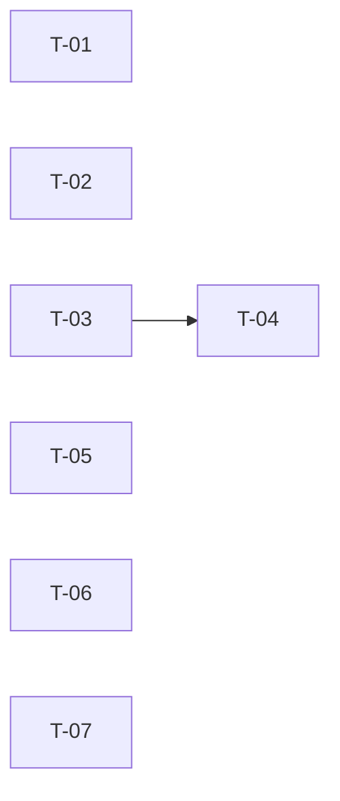

# fix-04 · Revue de la feature 11 : dividendes, splits et devise — Tâches

> Échelle de points, statuts et définition de terminé commune : `roadmap/README.md`. Points estimés a posteriori.

## Synthèse

| Tâche | Titre | US | Couche | Priorité | Points | Dépend de | Commits |
| --- | --- | --- | --- | --- | --- | --- | --- |
| T-01 | Bouton Dividendes et change toujours visible | US-01 | web | MUST | 1 | — | `8aad9e4` |
| T-02 | nativeButton false sur les boutons-liens | US-01 | web | MUST | 1 | — | `264967d` |
| T-03 | Migration d'origine restaurée, colonnes finales à part | US-01 | core-backend | MUST | 3 | — | `5f0d976` |
| T-04 | Revue : test de persistance des dividendes, JSDoc | US-01 | core-backend | MUST | 3 | T-03 | `b554a81` |
| T-05 | Aide des cartes, type DividendEvent du contrat | US-01 | web | MUST | 2 | — | `e1134bc` |
| T-06 | Résumé de résultat sans dividendEvents | US-01 | contracts | MUST | 2 | — | `0928220` |
| T-07 | priceType documenté, MarketExtras, test backtest.fx | US-01 | transverse | MUST | 2 | — | `d3d2285` |

**Total** : 14 points — MUST 14, SHOULD 0.

| Lot | Tâches | Points |
| --- | --- | --- |
| 1. Revue | T-01 → T-07 | 14 |

**Chemin critique** : aucun, tâches indépendantes sauf T-03 → T-04.

**Parallélisable** : toutes.

## Graphe des dépendances

---

## Lot 1 — Revue

### T-01 · Bouton Dividendes et change toujours visible

- **US** : US-01 · **Priorité** : MUST · **Points** : 1 · **Dépend de** : — · **Commits** : `8aad9e4`
- **Fichiers** : `apps/web`

Critères d'acceptation :
- [x] Visible sur un résultat.

### T-02 · nativeButton false sur les boutons-liens

- **US** : US-01 · **Priorité** : MUST · **Points** : 1 · **Dépend de** : — · **Commits** : `264967d`
- **Fichiers** : `apps/web`

Critères d'acceptation :
- [x] Plus d'avertissement base-ui.

### T-03 · Migration d'origine restaurée, colonnes finales à part

- **US** : US-01 · **Priorité** : MUST · **Points** : 3 · **Dépend de** : — · **Commits** : `5f0d976`
- **Fichiers** : `apps/core-backend/prisma/migrations`

Critères d'acceptation :
- [x] Deux migrations.

### T-04 · Revue : test de persistance des dividendes, JSDoc

- **US** : US-01 · **Priorité** : MUST · **Points** : 3 · **Dépend de** : T-03 · **Commits** : `b554a81`
- **Fichiers** : `apps/core-backend/test`

Critères d'acceptation :
- [x] Test de persistance ajouté.

### T-05 · Aide des cartes, type DividendEvent du contrat

- **US** : US-01 · **Priorité** : MUST · **Points** : 2 · **Dépend de** : — · **Commits** : `e1134bc`
- **Fichiers** : `apps/web/src/features/backtest`

Critères d'acceptation :
- [x] Type dérivé, pas de 0 inventé.

### T-06 · Résumé de résultat sans dividendEvents

- **US** : US-01 · **Priorité** : MUST · **Points** : 2 · **Dépend de** : — · **Commits** : `0928220`
- **Fichiers** : `packages/contracts`, `apps/core-backend`

Critères d'acceptation :
- [x] Résumé léger.

### T-07 · priceType documenté, MarketExtras, test backtest.fx

- **US** : US-01 · **Priorité** : MUST · **Points** : 2 · **Dépend de** : — · **Commits** : `d3d2285`
- **Fichiers** : `packages/contracts`, `apps/backtest-engine`

Critères d'acceptation :
- [x] TD-28 et TD-29 corrigées.
