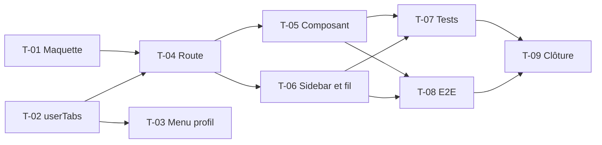

# fix-09 · Navigation automatique et pages d'index de section — Tâches

> Échelle de points, statuts et définition de terminé commune : `roadmap/README.md`. Points prévus. Un commit par tâche.

## Synthèse

| Tâche | Titre | US | Couche | Priorité | Points | Dépend de | Commits |
| --- | --- | --- | --- | --- | --- | --- | --- |
| T-01 | Maquette Figma : index de section, sidebar, fil d'Ariane | US-02 | design | MUST | 3 | — | `0567854` |
| T-02 | `userTabs`, `findActiveTab`, `findSectionPage`, `navigation.tabs.account` | US-01 | web | MUST | 3 | — | `624a4b1` |
| T-03 | Menu du profil généré et test de garde `sidebar.test.ts` | US-01 | web | MUST | 3 | T-02 | `664bcae` |
| T-04 | `routes.section`, page `sections/[section]` et garde admin partagée | US-02 | web | MUST | 3 | T-01, T-02 | `d02b6cf` |
| T-05 | Composant d'index de section et dictionnaires `descriptions` | US-02 | web | MUST | 5 | T-04 | `d105ec4` |
| T-06 | Sidebar et fil d'Ariane liés à la page d'index | US-02 | web | MUST | 2 | T-04 | `2cd9ac8` |
| T-07 | Tests : `findSectionPage`, `userTabs`, composant d'index | US-02 | web | MUST | 2 | T-05, T-06 | `aebfb85` |
| T-08 | E2E : titre de section → index → carte → page | US-02 | web | MUST | 2 | T-05, T-06 | `274c537`, `90c4a90` |
| T-09 | Catalogue `COMPONENTS.md` et clôture roadmap | US-02 | docs | MUST | 1 | T-07, T-08 | `f0ea033` |

**Total** : 24 points — MUST 24, SHOULD 0.

| Lot | Tâches | Points |
| --- | --- | --- |
| 1. Source unique | T-02, T-03 | 6 |
| 2. Pages d'index | T-01, T-04 → T-09 | 18 |

**Chemin critique** (16 points) : T-02 → T-04 → T-05 → T-07 → T-09. La maquette (T-01) bloque tout le lot 2.

**Parallélisable** : T-02 et T-01 ; T-03 avec T-04 ; T-07 et T-08.

## Graphe des dépendances

---

## Lot 1 — Source unique

### T-02 · `userTabs`, `findActiveTab`, `findSectionPage`, `navigation.tabs.account`

- **US** : US-01 · **Priorité** : MUST · **Points** : 3 · **Dépend de** : — · **Commits** : `624a4b1`
- **Fichiers** : `apps/web/src/constants/sidebar.tsx`, `src/lib/navigation.ts`, `messages/fr.json`, `messages/en.json`

Critères d'acceptation :
- [x] `userTabs` exporté ; `ActiveTab.section` optionnelle ; `navigation.account` déplacé, tous usages mis à jour.

### T-03 · Menu du profil généré et test de garde `sidebar.test.ts`

- **US** : US-01 · **Priorité** : MUST · **Points** : 3 · **Dépend de** : T-02 · **Commits** : `664bcae`
- **Fichiers** : `src/components/nav-user.tsx`, `test/sidebar.test.ts`

Critères d'acceptation :
- [x] Menu depuis `userTabs` ; le test (Glob de Bun, groupes `(…)` retirés, routes `[…]` ignorées) échoue si une page n'est rattachée à rien.

## Lot 2 — Pages d'index

### T-01 · Maquette Figma : index de section, sidebar, fil d'Ariane

- **US** : US-02 · **Priorité** : MUST · **Points** : 3 · **Dépend de** : — · **Commits** : `0567854`
- **Fichiers** : Figma `Trading`, section « Fix 09 »

Critères d'acceptation :
- [x] Écrans 41, 41.1, 42 et copies 35 et 06 dessinés ; validation explicite notée `validée le JJ/MM/AAAA` dans `US.md` (aucun code avant).

### T-04 · `routes.section`, page `sections/[section]` et garde admin partagée

- **US** : US-02 · **Priorité** : MUST · **Points** : 3 · **Dépend de** : T-01, T-02 · **Commits** : `d02b6cf`
- **Fichiers** : `src/lib/routes.ts`, `src/app/app/sections/[section]/page.tsx`, `src/lib/session.ts`

Critères d'acceptation :
- [x] 404 si section inconnue ou `adminOnly` non admin ; helper de garde partagé avec `(admin)/layout.tsx` ; `generateMetadata`.

### T-05 · Composant d'index de section et dictionnaires `descriptions`

- **US** : US-02 · **Priorité** : MUST · **Points** : 5 · **Dépend de** : T-04 · **Commits** : `d105ec4`
- **Fichiers** : `src/features/navigation/`, `messages/*.json`

Critères d'acceptation :
- [x] `PageHeader`, `Card`, `next/link` ; une carte par onglet ; clés `descriptions` et `sectionDescriptions` FR/EN, `tsc` casse si une description manque.

### T-06 · Sidebar et fil d'Ariane liés à la page d'index

- **US** : US-02 · **Priorité** : MUST · **Points** : 2 · **Dépend de** : T-04 · **Commits** : `2cd9ac8`
- **Fichiers** : `src/components/sidebar-nav.tsx`, `src/components/app-header.tsx`

Critères d'acceptation :
- [x] `SidebarGroupLabel` rendu en `Link` sans style de lien ; maillon de section lien ; maillon seul sur l'index ; Paramètres sans maillon de section.

### T-07 · Tests : `findSectionPage`, `userTabs`, composant d'index

- **US** : US-02 · **Priorité** : MUST · **Points** : 2 · **Dépend de** : T-05, T-06 · **Commits** : `aebfb85`
- **Fichiers** : `test/sidebar.test.ts`, `test/section-index.test.tsx`

Critères d'acceptation :
- [x] Une carte par onglet, bonne URL, section `adminOnly` absente pour un non-admin.

### T-08 · E2E : titre de section → index → carte → page

- **US** : US-02 · **Priorité** : MUST · **Points** : 2 · **Dépend de** : T-05, T-06 · **Commits** : `274c537`, `90c4a90`
- **Fichiers** : `apps/web/e2e/`

Critères d'acceptation :
- [x] Parcours ajouté au spec de navigation ; `bun run e2e` vert.

### T-09 · Catalogue `COMPONENTS.md` et clôture roadmap

- **US** : US-02 · **Priorité** : MUST · **Points** : 1 · **Dépend de** : T-07, T-08 · **Commits** : `f0ea033`
- **Fichiers** : `apps/web/COMPONENTS.md`, `roadmap/`

Critères d'acceptation :
- [x] Entrées à jour ; mode Clôture du skill ; `check.ts` sans erreur.

> Réalisé : 24 points, aucun écart d'un cran. T-08 inclut un correctif de `rates.e2e.ts` (`90c4a90`, cassé par la note ajoutée à la page Taux). Le test « section `adminOnly` absente pour un non-admin » est un E2E (T-08) : la garde est dans la page serveur, pas dans le composant.
