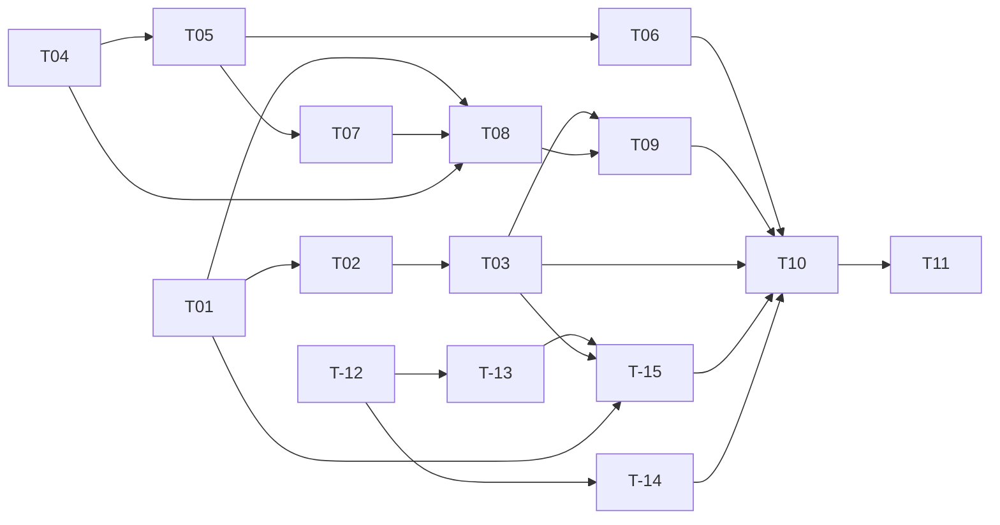

# fix-10 · Paramètres : profil et préférences de notification — Tâches

> Échelle de points, statuts et définition de terminé commune : `roadmap/README.md`. Points prévus. Un commit par tâche verte.

## Synthèse

| Tâche | Titre | US | Couche | Priorité | Points | Dépend de | Commits |
| --- | --- | --- | --- | --- | --- | --- | --- |
| T-01 | Maquettes Figma : Profil (06) et Notifications (06.1) | US-01 | design | MUST | 2 | — | |
| T-02 | `ProfileCard` : schéma, mutation `updateUser`, messages FR/EN, tests | US-01 | web | MUST | 5 | T-01 | |
| T-03 | Onglet Profil par défaut dans `SettingsTabs` | US-01 | web | MUST | 2 | T-02 | |
| T-04 | Contrat des préférences de notification | US-02 | contracts | SHOULD | 2 | — | |
| T-05 | notification-service : modèle, repository, service, routes, tests | US-02 | backend | SHOULD | 5 | T-04 | |
| T-06 | Consumer : écarter les catégories désactivées, tests | US-02 | backend | SHOULD | 3 | T-05 | |
| T-07 | core-backend : routes des préférences dans le proxy, `API.md` | US-02 | backend | SHOULD | 1 | T-05 | |
| T-08 | `NotificationPreferencesCard` : api, hook, interrupteurs, tests | US-02 | web | SHOULD | 5 | T-01, T-04, T-07 | |
| T-09 | Onglet Notifications dans `SettingsTabs`, catalogue | US-02 | web | SHOULD | 1 | T-03, T-08 | |
| T-10 | E2E Paramètres : nom, préférence et réinitialisation | US-04 | web | MUST | 4 | T-03, T-06, T-09, T-14, T-15 | |
| T-11 | Clôture : catalogues, `TECH-DEBT.md`, roadmap | US-04 | docs | MUST | 1 | T-10 | |
| T-12 | Contrat `user.data.reset` | US-03 | contracts | MUST | 2 | — | |
| T-13 | core-backend : route `POST /api/account/reset`, transaction, événement, tests | US-03 | backend | MUST | 5 | T-12 | |
| T-14 | notification-service : consumer `user.data.reset`, tests | US-03 | backend | MUST | 3 | T-12 | |
| T-15 | `ResetDataCard` et dialog de confirmation, tests | US-03 | web | MUST | 5 | T-01, T-03, T-13 | |

**Total** : 46 points — MUST 29, SHOULD 17.

| Lot | Tâches | Points |
| --- | --- | --- |
| 1. Profil | T-01 → T-03 | 9 |
| 2. Préférences de notification | T-04 → T-09 | 17 |
| 3. Réinitialisation des données | T-12 → T-15 | 15 |
| 4. Preuve et clôture | T-10, T-11 | 5 |

**Chemin critique** (17 points) : T-04 → T-05 → T-07 → T-08 → T-09 → T-10 → T-11. T-08 (mise à jour optimiste) et T-13 (suppression irréversible en transaction) sont les plus risquées : T-13 se commence tôt.

**Parallélisable** : lots 1, 2 et 3 entre eux (seul T-10 les réunit) ; T-06 et T-07 ; T-13 et T-14.

## Graphe des dépendances

---

## Lot 1 — Profil

### T-01 · Maquettes Figma : Profil (06) et Notifications (06.1)

- **US** : US-01 · **Priorité** : MUST · **Points** : 2 · **Dépend de** : — · **Fait** : 2026-11-24, à valider
- **Fichiers** : Figma `Trading`, section `681:15865` : `06` (`681:15866`), `06.1` (`681:15933`), `06.2` (`681:16004`), `06.3` dialog (`681:16073`)

Critères d'acceptation :
- [x] 06 : onglet Profil sans « Changer la photo », e-mail atténué avec note, sans cartes Portefeuille ni Apparence, carte « Données » (« Réinitialiser mes données ») ; onglets Profil, Notifications, Apparence.
- [x] 06.1 : deux interrupteurs (Backtests, Risque), sans carte « Canaux de réception » ; 06.2 : barre à trois onglets ; fil d'Ariane « Compte » seul (D5 de fix-09).
- [x] 06.3 : dialog de réinitialisation (récapitulatif, saisie `RÉINITIALISER`, bouton désactivé).
- [ ] États erreur et enregistrement dessinés ; validation de l'utilisateur avant T-02, T-08 et T-15.

### T-02 · `ProfileCard` : schéma, mutation `updateUser`, messages FR/EN, tests

- **US** : US-01 · **Priorité** : MUST · **Points** : 5 · **Dépend de** : T-01
- **Fichiers** : `apps/web/src/features/settings/profile-card.tsx`, `schema.ts`, `hook.ts`, `src/lib/auth.ts` (export `updateUser`), `messages/fr.json`, `messages/en.json`, `test/profile-card.test.tsx`

Critères d'acceptation :
- [ ] Champs `Form` existants (`components/form/`), `SettingsCard` pour le cadre ; schéma zod en fabrique (messages traduits), nom de 1 à 100 caractères.
- [ ] `updateUser({ name })` ; la session est relue (`authClient` sans cache de cookie) pour que `nav-user` change aussitôt.
- [ ] Toast de succès ; erreur serveur affichée, saisie conservée.
- [ ] Tests : validation, bouton désactivé sans changement, appel et erreur (`authClient` espionné).

### T-03 · Onglet Profil par défaut dans `SettingsTabs`

- **US** : US-01 · **Priorité** : MUST · **Points** : 2 · **Dépend de** : T-02
- **Fichiers** : `features/settings/settings-tabs.tsx`, `COMPONENTS.md` (settings), `messages/*.json` (`settings.tabs.profile`), `test/`

Critères d'acceptation :
- [ ] Onglets Profil (défaut) puis Apparence ; JSDoc et catalogue à jour (le commentaire « seul Apparence existe » disparaît).
- [ ] Test de rendu des onglets.

## Lot 2 — Préférences de notification

### T-04 · Contrat des préférences de notification

- **US** : US-02 · **Priorité** : SHOULD · **Points** : 2 · **Dépend de** : —
- **Fichiers** : `packages/contracts/src/notification.ts`, `packages/contracts/test/`

Critères d'acceptation :
- [ ] `notificationPreferencesSchema` : un booléen par entrée de `NOTIFICATION_CATEGORIES` ; type dérivé par `z.infer`, jamais recopié.
- [ ] Schéma de mise à jour partielle (au moins une catégorie) ; tests du schéma.

### T-05 · notification-service : modèle, repository, service, routes, tests

- **US** : US-02 · **Priorité** : SHOULD · **Points** : 5 · **Dépend de** : T-04
- **Fichiers** : `apps/notification-service/prisma/schema.prisma` + migration, `repositories/`, `services/`, `routes/notification/`, `controller/`, `API.md`, `test/`

Critères d'acceptation :
- [ ] `NotificationPreference` (`userId` unique, un booléen par catégorie `@default(true)`), sans clé étrangère.
- [ ] `GET /api/notifications/preferences` (ligne absente = tout activé, sans l'écrire) et `PUT` (upsert) ; `userId` pris de `x-user-id`, jamais du corps.
- [ ] Logique dans le service, Prisma dans le repository ; tests de repository (`describeWithDb`), service (faux repository) et route (`startApp`).
- [ ] Migration rappelée au résumé (`bun run db:generate`) ; `API.md` du service à jour.

### T-06 · Consumer : écarter les catégories désactivées, tests

- **US** : US-02 · **Priorité** : SHOULD · **Points** : 3 · **Dépend de** : T-05
- **Fichiers** : `services/notification.service.ts` (`record`), `consumers/notification.consumer.ts`, `test/notification.service.test.ts`, `test/notification.consumer.test.ts`

Critères d'acceptation :
- [ ] `record` lit les préférences de `payload.userId` ; catégorie désactivée : ni insertion ni diffusion SSE, `logger.info` et retour `null`.
- [ ] Message invalide : `logger.warn` et retour, jamais d'exception ; base indisponible : l'exception repart à kafkajs.
- [ ] Tests : catégorie désactivée, activée, préférence absente, rejeu.

### T-07 · core-backend : routes des préférences dans le proxy, `API.md`

- **US** : US-02 · **Priorité** : SHOULD · **Points** : 1 · **Dépend de** : T-05
- **Fichiers** : `apps/core-backend/routes/notification/notification.routes.ts`, `API.md`, test de route du proxy

Critères d'acceptation :
- [ ] `GET` et `PUT /api/notifications/preferences` ajoutés à la liste blanche, sous `authMiddleware`, `x-user-id` remplacé par `req.userId`.
- [ ] Entrée `API.md` (gabarit du catalogue) ; test : sans session `401`.

### T-08 · `NotificationPreferencesCard` : api, hook, interrupteurs, tests

- **US** : US-02 · **Priorité** : SHOULD · **Points** : 5 · **Dépend de** : T-01, T-04, T-07
- **Fichiers** : `features/settings/notification-preferences-card.tsx`, `api.ts`, `hook.ts`, `messages/*.json`, `test/notification-preferences.test.tsx`

Critères d'acceptation :
- [ ] `Switch` shadcn (`components/ui/switch.tsx`), `fetch` uniquement dans `api.ts`, types dérivés du contrat.
- [ ] Mise à jour optimiste avec retour arrière et toast d'erreur ; état de chargement sans clignotement.
- [ ] Tests : affichage des valeurs reçues, bascule, retour arrière sur erreur.

### T-09 · Onglet Notifications dans `SettingsTabs`, catalogue

- **US** : US-02 · **Priorité** : SHOULD · **Points** : 1 · **Dépend de** : T-03, T-08
- **Fichiers** : `features/settings/settings-tabs.tsx`, `COMPONENTS.md` (settings), `messages/*.json`

Critères d'acceptation :
- [ ] Ordre : Profil, Notifications, Apparence ; entrées `COMPONENTS.md` des nouveaux composants.

## Lot 3 — Réinitialisation des données

### T-12 · Contrat `user.data.reset`

- **US** : US-03 · **Priorité** : MUST · **Points** : 2 · **Dépend de** : —
- **Fichiers** : `packages/contracts/src/` (topic en constante, `userDataResetPayloadSchema`), `packages/contracts/test/`

Critères d'acceptation :
- [ ] Topic `user.data.reset` en constante ; payload `{ userId }` dans l'enveloppe `KafkaEvent` ; test du schéma.
- [ ] Producteur et consommateur importent ce contrat (jamais recopié).

### T-13 · core-backend : route `POST /api/account/reset`, transaction, événement, tests

- **US** : US-03 · **Priorité** : MUST · **Points** : 5 · **Dépend de** : T-12
- **Fichiers** : `apps/core-backend/routes/`, `controller/`, `services/`, `repositories/`, `API.md`, `test/`

Critères d'acceptation :
- [ ] `authMiddleware` ; `userId` de `req.userId`, jamais du corps ; réponse `204`.
- [ ] Service : une `$transaction` Prisma supprime backtests (allocations et exécutions en cascade), portefeuilles et calculs de pricing du seul utilisateur ; aucun SQL brut ; le repository porte Prisma, le service la règle.
- [ ] `user.data.reset` publié après le succès de la transaction ; échec de transaction : rien publié, erreur remontée.
- [ ] Tests : suppression des seules lignes de l'utilisateur (repository sur `trading_test`), publication (faux repository), route (`startApp`), `401` sans session.
- [ ] Un résultat de calcul qui arrive après la suppression : consumers `backtest.completed` et `risk.completed` ignorent la ligne absente (`logger.warn`, retour) ; test ajouté si le cas n'est pas déjà couvert.
- [ ] `API.md` : entrée `POST /api/account/reset` (effet irréversible, événement publié) ; redémarrage des services signalé.

### T-14 · notification-service : consumer `user.data.reset`, tests

- **US** : US-03 · **Priorité** : MUST · **Points** : 3 · **Dépend de** : T-12
- **Fichiers** : `apps/notification-service/consumers/`, `services/`, `repositories/`, `test/`

Critères d'acceptation :
- [ ] Supprime les notifications de `userId` (préférences conservées) et ferme rien d'autre ; idempotent (rejeu = même état).
- [ ] Message invalide : `logger.warn` et retour ; base indisponible : l'exception repart à kafkajs.
- [ ] Tests : suppression des seules notifications de l'utilisateur, rejeu, message invalide.

### T-15 · `ResetDataCard` et dialog de confirmation, tests

- **US** : US-03 · **Priorité** : MUST · **Points** : 5 · **Dépend de** : T-01, T-03, T-13
- **Fichiers** : `apps/web/src/features/settings/reset-data-card.tsx`, `reset-data-dialog.tsx`, `api.ts`, `hook.ts`, `messages/*.json`, `COMPONENTS.md` (settings), `test/reset-data.test.tsx`

Critères d'acceptation :
- [ ] Carte « Données » dans l'onglet Profil et dialog `06.3` (`AppDialog` / primitive existante), texte conforme à la maquette, FR et EN.
- [ ] Confirmation désactivée tant que `RÉINITIALISER` n'est pas saisi (comparaison sur la valeur affichée).
- [ ] Succès : tous les caches de données invalidés, dialog fermé, toast ; échec : message d'erreur, dialog ouvert.
- [ ] Tests : bouton désactivé puis activé, appel de l'API, succès et erreur.

## Lot 4 — Preuve et clôture

### T-10 · E2E Paramètres : nom, préférence et réinitialisation

- **US** : US-04 · **Priorité** : MUST · **Points** : 4 · **Dépend de** : T-03, T-06, T-09, T-14, T-15
- **Fichiers** : `apps/web/e2e/settings.e2e.ts`

Critères d'acceptation :
- [ ] Renommer l'utilisateur : le nouveau nom apparaît dans la sidebar.
- [ ] Désactiver « Backtests », recharger : l'interrupteur reste désactivé ; le parcours ne vérifie aucun chiffre.
- [ ] Créer un backtest, réinitialiser (saisie `RÉINITIALISER`), la liste des backtests est vide ; l'utilisateur reste connecté.

### T-11 · Clôture : catalogues, `TECH-DEBT.md`, roadmap

- **US** : US-04 · **Priorité** : MUST · **Points** : 1 · **Dépend de** : T-10
- **Fichiers** : `TECH-DEBT.md`, `roadmap/fix-10-parametres-profil/`, `roadmap/README.md`

Critères d'acceptation :
- [ ] `TECH-DEBT.md` : onglet Portefeuille (feature paper trading), canaux e-mail et navigateur, changement d'e-mail et de mot de passe, photo, suppression de compte.
- [ ] Cases cochées, commits et points réalisés, bilan du README ; statut `Livrée` dans l'index.
