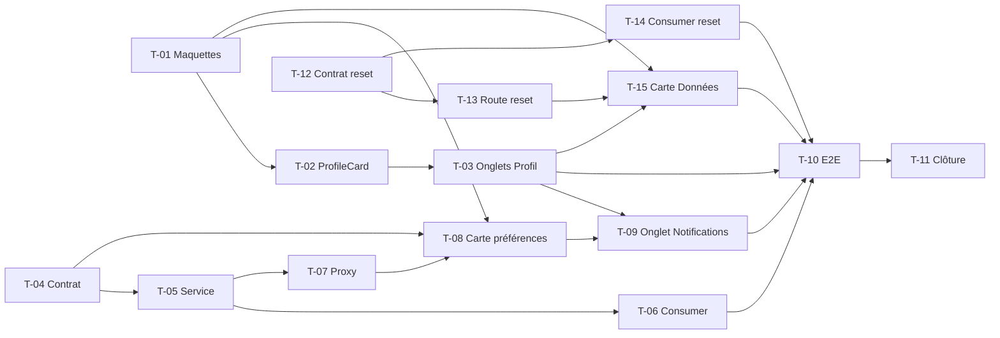

# fix-10 · Paramètres : profil et préférences de notification — User stories

> Sources : demande du 2026-11-24 (« terminer la partie paramètres »), maquettes `06`, `06.1`, `06.2` (Figma `Trading`), `roadmap/15-notification-service` (D11 : préférences hors périmètre en 15).

## Point de départ

| Couche | Existant | Manque |
| --- | --- | --- |
| `web/features/settings` | `SettingsTabs` (onglet Apparence seul), `SettingsCard`, `ThemeCard`, `LanguageCard` | `ProfileCard`, `NotificationPreferencesCard`, onglets Profil et Notifications |
| `web/lib/auth.ts` | `authClient` (`signIn`, `signUp`, `signOut`, `useSession`) | export de `updateUser` |
| `core-backend` | better-auth sur `/api/auth/*` ; proxy notification en liste blanche (`routes/notification/notification.routes.ts`) | routes des préférences dans la liste blanche, entrée `API.md` |
| `notification-service` | modèle `Notification`, enum `NotificationCategory` (`BACKTESTS`, `RISK`), `NotificationService.record` | modèle `NotificationPreference`, routes, filtre dans le consumer |
| `packages/contracts` | `NOTIFICATION_CATEGORIES`, `NOTIFICATION_CATEGORY_BY_TYPE` | schéma des préférences |
| `web/e2e` | `notifications.e2e.ts` | spec Paramètres |

## Hors périmètre

- Onglet « Portefeuille » et réinitialisation (maquettes 29, 29.1) : avec le paper trading.
- Changement d'e-mail, de mot de passe, photo de profil.
- Suppression du compte lui-même, export des données avant effacement.
- Canaux e-mail et navigateur, résumé quotidien, alertes de prix, exécution d'ordres.

## Décisions à valider

Voir `README.md` (D1 à D9).

---

## User stories

### Lot 1 — Profil

#### US-01 · Modifier mon nom — MUST

**En tant qu'** utilisateur connecté, **je veux** corriger mon nom dans Paramètres **afin que** la sidebar et mes écrans l'affichent.

Critères d'acceptation :
- [ ] Onglet « Profil » par défaut : carte avec nom (modifiable) et e-mail (lecture seule), bouton « Enregistrer » désactivé tant que rien n'a changé.
- [ ] Un nom vide ou de plus de 100 caractères est refusé avec un message traduit (FR et EN).
- [ ] Après enregistrement, le nom de la sidebar (`nav-user`) change sans rechargement et un toast confirme ; une erreur du serveur s'affiche sans perdre la saisie.
- [ ] Maquettes `06` et `06.1` mises à jour dans Figma avant le code.

Tâches : T-01, T-02, T-03.

### Lot 2 — Préférences de notification

#### US-02 · Choisir les catégories de notification — SHOULD

**En tant qu'** utilisateur, **je veux** désactiver les notifications de backtests ou de risque **afin de** ne recevoir que ce qui me concerne.

Critères d'acceptation :
- [ ] Onglet « Notifications » : un interrupteur par catégorie (Backtests, Risque), activés par défaut pour tout utilisateur existant.
- [ ] Un changement est enregistré aussitôt (mise à jour optimiste, retour arrière et toast en cas d'erreur) et retrouvé après rechargement.
- [ ] Catégorie désactivée : le consumer n'enregistre rien et ne diffuse rien pour ce type, un message Kafka invalide ou rejoué reste sans effet (idempotence).
- [ ] La préférence d'un utilisateur ne touche jamais celle d'un autre ; sans session, `401`.
- [ ] Le champ ajouté est `@default(true)` côté Prisma ; contrat et routes à jour dans le même diff.

Tâches : T-04 à T-09.

### Lot 3 — Réinitialisation des données

#### US-03 · Réinitialiser mes données — MUST

**En tant qu'** utilisateur, **je veux** effacer tout ce que j'ai créé **afin de** repartir d'un laboratoire vide.

Critères d'acceptation :
- [ ] Onglet Profil, carte « Données » : bouton « Réinitialiser » ouvre le dialog `06.3` ; le bouton de confirmation reste désactivé tant que `RÉINITIALISER` n'est pas saisi.
- [ ] Après confirmation : backtests (allocations et exécutions comprises), portefeuilles, calculs de pricing et notifications de l'utilisateur sont supprimés ; compte, session, rôle, préférences et données des autres utilisateurs sont intacts.
- [ ] Suppression côté `trading` en une transaction (tout ou rien) ; événement `user.data.reset` publié seulement après son succès ; notification-service supprime ses notifications, un rejeu ne change rien.
- [ ] Une exécution encore en cours ne fait pas planter le consumer à son retour : ligne absente, `logger.warn` et retour.
- [ ] L'écran se vide sans rechargement (caches invalidés), toast de confirmation, erreur affichée sans fermer le dialog.
- [ ] Contrat, producteur et consommateur dans le même diff ; services à redémarrer signalés.

Tâches : T-12 à T-15.

### Lot 4 — Preuve et clôture

#### US-04 · Parcours Paramètres vérifié de bout en bout — MUST

**En tant que** développeur, **je veux** un E2E des onglets **afin de** garder la page terminée.

Critères d'acceptation :
- [ ] E2E : renommer l'utilisateur, voir le nouveau nom dans la sidebar ; désactiver une catégorie, recharger, la retrouver désactivée ; créer un backtest, réinitialiser, liste vide.
- [ ] Catalogues `COMPONENTS.md` (settings), `API.md` (core-backend et notification-service) à jour ; roadmap clôturée, dettes (Portefeuille, canaux) dans `TECH-DEBT.md`.

Tâches : T-10, T-11.

## Graphe des dépendances

